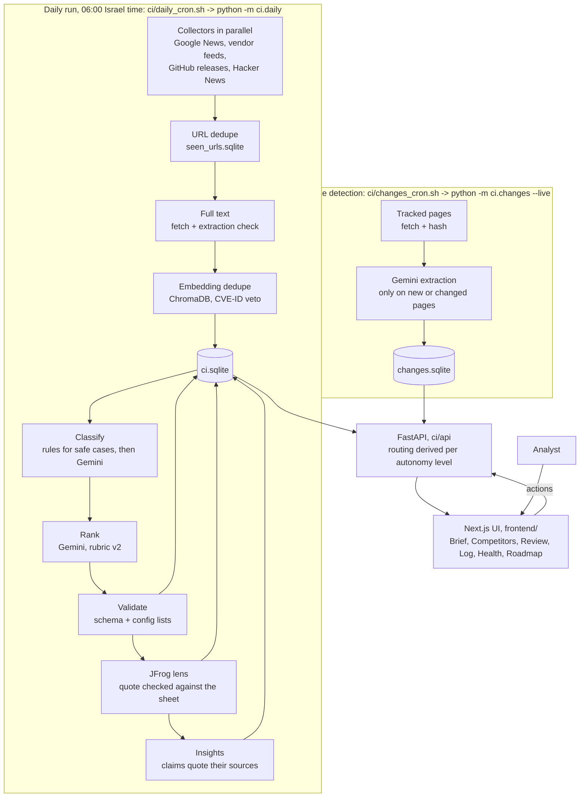
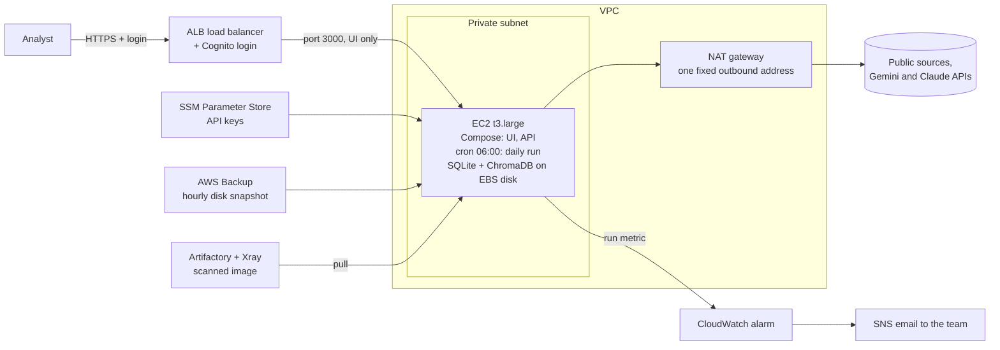

# Architecture

Two parts:

1. **[How Jessi works today](#part-1-how-jessi-works-today)**: what runs now, from the code and the PRD.
   **Runs today.**
2. **[Production on AWS](#part-2-production-on-aws)**: a design only. **None of it is built or tested for Jessi.**
   The submission runs on one Raspberry Pi and with `docker compose up --build`.

Decision IDs (Dnn) refer to [DECISIONS.md](DECISIONS.md) and the PRD's decision log.

---

## Part 1. How Jessi works today

> **Status: Runs today**, on one Raspberry Pi. The demo runs the same API and UI with `docker compose up`.

Jessi is a GenAI pipeline with fixed steps, validation and human review. `run_daily()` in `ci/daily.py` calls the
steps in order, in plain Python: collect, store, classify, rank, validate and route, lens, then insights if enabled.
Thread pools run only during collection. LangGraph is imported only in `modules/graph.py`, used by the legacy
newsletter path; `ci/` does not use it (D117).

### 1.1 Flow

Routing is not a pipeline step that writes a status. The API derives each item's status from its stored outputs,
the hold reasons and the current autonomy level (`ci/route.py`); analyst decisions override it (`item_state`).

### 1.2 What each component does

| Component | Code | What it does | Decision |
| --- | --- | --- | --- |
| Schedule | `ci/daily_cron.sh`, `ci/changes_cron.sh` | Host cron at 06:00 Israel time runs the daily run, then change detection, then `ci.reliability make`. The scripts call the host's Python environment (`.venv`), not Docker | D21 |
| One run at a time | `ci/runlock.py` | A file lock per job | — |
| Collectors | `ci/collectors/` | Pull items from Google News queries, vendor blogs and changelogs, GitHub releases and Hacker News, in parallel. One broken collector cannot stop the others | D10 |
| Dedupe | `ci/dedupe.py`, `ci/pipeline.py` | Drops URLs already seen, then near-duplicates by embedding similarity. Two items that name different CVE IDs are never merged | D6, D38 |
| Full text | `ci/pipeline.py`, `modules/reader.py` | Fetches the page and records whether extraction worked, and why not (for example a Cloudflare challenge). Up to 6,000 characters are stored | D39, D57 |
| Classify | `ci/classify.py` | Competitor, one of 7 categories, noise, and the Mentions JFrog flag. Rules settle only the safe cases; the rest goes to Gemini | D11, D24, D25 |
| Rank | `ci/rank.py` | Scores 1-5 on rubric v2 (`config/rubric_v2.md`): competitive impact on JFrog | D14, D29 |
| Validate | `ci/validate.py` | Every model answer is checked: score, competitor and category from the config lists, known item ids. A rejected answer is logged and its item goes to review | D32 |
| Test-split guard | `ci/daily.py` | Items in the golden-set test split skip the model; without the split file the run stops before any LLM call | D23 |
| JFrog lens | `ci/lens.py` | For each non-noise item: the closest JFrog capability axis and a phrase quoted word for word from `config/jfrog_capabilities.md`, checked in code. It never changes a score | D42, D58 |
| Insights | `ci/insights.py` | Patterns across at least 2 stories over a 7-day window (14 with fewer than 15 stories). Every claim must quote its cited article, checked in code. Off on a fresh store until `insights_enabled` is set | D37, D50 |
| Run record | `ci/run_metrics.py`, `ci/run_meta.py` | One `run_metrics` row per run, ok, degraded or failed, with its commit, fingerprints and counts | D48, D59 |
| Change detection | `ci/changes/` | Hashes tracked pages; on a new or changed page, Gemini re-extracts the head-to-head cell. Values are unverified and captioned as such | D13, D88 |
| Routing | `ci/route.py` | Hold reasons × three autonomy levels (Strict, Balanced, Relaxed) decide auto-publish or review | D9, D34, D36 |
| API | `ci/api/` | FastAPI over the store. Accepts only known Host names and refuses cross-site writes (`ci/csrf.py`). Binds 127.0.0.1 | D36, D59 |
| UI | `frontend/` | Next.js. Five screens plus the Roadmap | D3, D21 |
| Demo | `ci/demo.py`, `demo/snapshot/` | Serves the frozen 1 Nov snapshot with no key. Each start copies it to a temporary folder; actions write only there | D2, D69, D111 |
| Reproducibility | `ci/repro.py`, `repro/` | Recomputes every reported eval number from saved reports, with no model call | D59 |
| Fingerprints | `tools/lock_check.py` | Proves the measured prompts, rules and config are unchanged | D59, D99 |

**Runs today, on the Pi** (from the AWS design file, section 1):

| Part | What runs | Decision |
| --- | --- | --- |
| Pipeline | Plain Python: `run_daily()` calls collect → store → classify (rules first, then Gemini Flash) → rank → validate and route → JFrog lens → insights, if enabled. Thread pools run only during collection. LangGraph is imported only in `modules/graph.py` (legacy newsletter path) | D5, D25, D117 |
| Store | SQLite files on the Pi's disk: `ci.sqlite`, `changes.sqlite`, `seen_urls.sqlite`. ChromaDB, also on disk, holds the dedupe embeddings and is used only by the run, never by the API | D6 |
| Live API and UI | They run outside Docker: `python -m ci.api --port 8011` and `next start` on port 3017, both on 127.0.0.1 | D3 |
| Demo | `docker compose up` serves a frozen snapshot with no API key. Actions write to a temporary copy. The Compose `api` and `ui` services are demo-only | D2, D111 |
| Access | SSH tunnel or Tailscale. No user login | — |
| Backups | A file copy before any write to the live store | — |
| LLM keys | In `.env` on the Pi | — |

Limits of this setup: it is one machine, and a missed run alerts nobody. It shows on the Health page only when
someone opens it.

### 1.3 Data model

Three SQLite files under `data/ci/`, plus ChromaDB for dedupe embeddings. Table names and columns are from the
stores' schemas; per BE on 4 Nov, the live `ci.sqlite` has 14 tables and 1,916 rows, and `changes.sqlite` 5 tables
and 114 rows (D115).

**`ci.sqlite`: items and everything decided about them**

| Table | One row per | Holds |
| --- | --- | --- |
| `items` | collected item | URL, source, prefilled competitor, title, `published_at` (feed date), `discovered_at`, the first run, the raw item |
| `sightings` | item × run | each run that saw the item again |
| `runs` | run | kind (daily or import), start, processing and finish times, status (running, ok, degraded, failed), fingerprint, model, error, report |
| `run_metrics` | run | status, fingerprints (classify_rank, lens, insights) and the counts Health shows |
| `classifications` | item × run | competitor, category, noise, Mentions JFrog, confidence, method (rules, LLM or fallback), degraded, fingerprint |
| `rankings` | item × run | score, raw score before code adjustments, noise, degraded, needs review, fingerprint |
| `skips` | item × run | why the model was not called (for example the golden-set test split) |
| `rejections` | rejected answer | item, run, stage (classifier, ranker, output) and reason (D32) |
| `lens` | item × run | status (ok, rejected, failed), axis, capability quote, relation, why, reason |
| `insights` | generation | Brief date, trigger (daily or refresh), level, status, fingerprint, model, the insights and their window. Every generation is kept; the latest is shown |
| `item_state` | item | the analyst's decision (approved, dismissed), the flag, edits to competitor, category or score. Routing is derived; this only overrides it |
| `analyst_actions` | action | append-only history: approve, dismiss, edit, flag, unflag, trust, untrust, with before and after values (D62) |
| `trusted_sources` | host | sources an analyst trusted, on top of `config/vetted_sources.yaml` (D34) |
| `settings` | key | the autonomy level, `insights_enabled` |

**`changes.sqlite`: tracked pages and head-to-head cells**

| Table | Holds |
| --- | --- |
| `snapshots` | each tracked page's URL, hash and fetch time |
| `cells` | the current head-to-head value per competitor × axis, with evidence, source URL, as-of date, stale and review flags |
| `cell_history` | every earlier value of a cell, with the run and the change |
| `changes` | each detected change, published as an item |
| `change_state` | an analyst's decision on a change |

**`seen_urls.sqlite`** holds every URL already collected, so a later run skips it.

**Config files** (`config/`): `competitors.yaml`, `rubric_v2.md`, `jfrog_capabilities.md` (the capability sheet the
lens and insights quote), `vetted_sources.yaml`, `tracked_pages.yaml`, `brief.yaml`.

---

## Part 2. Production on AWS

> **Status. Design only: none of it is built or tested for Jessi.** The submission runs on the Pi and with
> `docker compose up --build`. Source: `audits/aws-production-design.md` (final, D116).

Jessi's workload is small. The source for every number in this paragraph is `run_metrics` in the live store
(`data/ci/ci.sqlite`), read on 4 Nov 2026.

- **Run size.** A daily run collected 237–258 items, and 13–46 of them were new and sent to the model (n = 5 daily
  runs, 31 Oct to 4 Nov).
- **LLM calls.** Gemini calls per run, as counted by `CountingLLM` in `ci/daily.py`, were 5–13 (n = 4, 1 to 4 Nov;
  the 31 Oct run did not record the count). Claude judge calls, if any, are not in that count.
- **Run time.** A run took 2.7–6.2 minutes from start to finish (n = 5).
- **A fresh store is much heavier.** The first import sent 256 items to the model, against 13–46 on a normal day.
  That run did not record its LLM calls, and its 24-hour span between start and finish is not a run time. A clean
  clone on 4 Nov collected 169 items and stored 135, and with no key it wrote fallback rows for 128 of them (per BE,
  19:52). That no-key run counted 37 attempted LLM calls (n = 1). None of them reached a model API, so they are
  attempts, not real calls, but they show the scale against 5–13 on a normal day. So a first run on an empty store
  sends several times more items to the model, and makes several times more calls, than a normal day.

So step 1 moves today's stack onto one EC2 instance and changes no Python or frontend code, as far as checked. It
does need the configuration and script changes listed in section 2.1. Each later step starts when a stated trigger
is reached.

### 2. Step 1 on AWS: one EC2 instance (design only, not built)

#### 2.1 What step 1 must change (none of it built)

The application code stays as it is. These configuration and script changes are still needed:

| # | Change | Why it is needed | Kind |
| --- | --- | --- | --- |
| 1 | A production Compose file for the live system: the API without `CI_DEMO_DIR`, with the data, output and evals folders mounted, and the Gemini key in its environment (Refresh insights calls Gemini). The UI is built for live use instead of `CI_MODE=demo` | Today's Compose `api` and `ui` serve only the demo, and the live system runs outside Docker | Configuration |
| 2 | Publish the UI's port on the instance's private address, not 127.0.0.1. Only the ALB may reach it (security group). The API port is not published at all | Compose publishes the UI on 127.0.0.1:3000, and a load balancer cannot reach a loopback address | Configuration |
| 3 | Check in the shadow week that the API still sees the Host `api` behind the ALB, and add the ALB's domain to `CI_TRUSTED_HOSTS` only if it doesn't | The browser talks only to the UI, and the UI's server forwards `/api/v1/*` to `http://api:8011`. The demo Compose already trusts `api` for that hop. The hop is expected to keep that Host, but it has not been tested behind an ALB | Verify, maybe configuration |
| 4 | No change to the CSRF guard | Behind the ALB the browser still sends `Sec-Fetch-Site: same-origin`, which the guard accepts (checked in `ci/csrf.py`) | — |
| 5 | Cron calls the pipeline inside the image (`docker compose run --rm` with `ci.daily`, `ci.changes --live` and `ci.reliability make`). That needs new Compose services or entrypoints | Today's cron scripts call the host's `.venv`. The server is meant to have no build tools, and Compose's `ci` service runs only collection (`ci.run`) | Configuration and script |
| 6 | A start script that reads the keys from Parameter Store and passes them to the containers | Keys move out of `.env` | Script |
| 7 | An addition to the cron script that sends a success metric, or a failure metric when the run fails or ends degraded (exit 3), to CloudWatch | The alarms need it | Script |
| 8 | Install and configure the CloudWatch agent for the logs | Logs reach CloudWatch | Configuration |
| 9 | An HTTPS listener on the ALB, with a certificate and a domain name (section 2.2) | The ALB checks a Cognito login only on HTTPS | Configuration |

Not covered by step 1: the app has no users, so even behind a login, the Log does not record who approved or
dismissed an item. Recording it would mean reading the ALB's identity header, which is a code change.

#### 2.2 Components (design only, not built)

| Component | Choice | What it does, and why over the simpler option |
| --- | --- | --- |
| Server | One EC2 **t3.large** (2 vCPU, 8 GiB) with a 30 GB gp3 disk (EBS). Use t3a.large if it is cheaper in the chosen region | It runs the Compose stack and cron in one place, like the Pi does. The target is x86_64: the Pi's ARM processor came from developing on a Pi, not from a decision. The full stack, including ChromaDB and its native libraries, is built and checked on AMD64 during the shadow week. Memory, CPU credits and run time are watched before any resize |
| Store | SQLite and ChromaDB on the instance's disk (EBS) | This keeps the riskiest code change out of step 1. SQLite-specific SQL sits in 9 files, and the demo must stay on SQLite either way |
| Load balancer | **ALB** | **What it does:** it receives every request from the browser and passes it on to the server. **Why:** the simpler option is to give the server a public address, but then the server is exposed to the internet, and nothing checks a login before the app |
| Login | **Cognito** | **What it does:** it is AWS's user directory and login page, and the ALB asks it whether the user is signed in before any request reaches the app. **Why:** the simpler option is to write a login into the app, but that is new security code to own, and Cognito can later hand off to JFrog's own identity provider |
| HTTPS certificate | A TLS certificate on the ALB, issued and renewed by AWS Certificate Manager (design only) | **What it does:** it proves to the browser that the site is really ours and encrypts the traffic between the browser and the ALB. **Why it is needed:** the ALB runs the Cognito login only on an HTTPS listener, and without encryption the login and the analysts' data would cross the network readable |
| Domain name | A name such as a subdomain under JFrog's internal domain, pointing at the ALB (design only) | **What it does:** it gives analysts a stable address to open instead of the ALB's long generated one. **Why it is needed:** a certificate is issued for a name, and Cognito sends the user back to a fixed address after login, so both need a name we control |
| Network | **Private subnet** | **What it does:** it is a part of the network with no route in from the internet, so the server has no public address. **Why:** the simpler option is a public subnet with a locked security group. That works, but one wrong rule would expose the server, while a private subnet cannot be reached from outside at all |
| Outbound | **NAT gateway** | **What it does:** it lets servers in the private subnet open connections out to the internet, which the run needs for fetching pages and calling the LLMs, while nothing can connect in. **Why:** the simpler option is a public address on the server, which saves about $35 a month (unverified estimate, section 5), but loses the private subnet's protection. All fetches also leave from one fixed address, which shows quickly if sites start blocking us |
| API keys | **SSM Parameter Store** | **What it does:** it stores the keys encrypted, and only the instance's IAM role is allowed to read them. **Why:** the simpler option is `.env` on the disk, as on the Pi, but then the keys sit in every hourly snapshot. Secrets Manager adds automatic rotation, but these API keys can't be rotated automatically anyway |
| Admin shell | **SSM Session Manager** | **What it does:** it opens a shell on the server from the AWS console or CLI. **Why:** the simpler option is SSH through a second public server, but that means an open port 22, SSH keys to manage and one more server to patch. Session Manager needs none of that, and it logs every session |
| Backup | **AWS Backup** | **What it does:** it runs a backup plan that takes a snapshot of the whole disk every hour and deletes old ones. A snapshot is a full copy of the disk at that moment, so SQLite, ChromaDB and the run files are all covered. **Why:** the simpler option is a cron line that calls the snapshot command, but that is code we own, and it stops if the instance dies. In step 2 the same plan can back up RDS. A snapshot of a running disk behaves like a sudden power cut, and SQLite is built to recover from that |
| Alerts | **CloudWatch** alarm, then **SNS** email | A run that starts and fails alerts at once, through its own failure metric. A degraded run (exit 3) alerts the same way, because a degraded morning means a Brief built partly on fallback rows. A second alarm fires when the success metric has been missing for 26 hours, meaning a run never started or never finished. That alarm also covers the whole instance going down. Design only: the metric is not sent today |
| Deploy | Build once, scan with **Xray**, push to **Artifactory**, then the server pulls the image and runs it | Requirement: everything running in production has been scanned. Choice: Artifactory and Xray rather than ECR, because the scan and the registry sit on one platform. This is a design and has not been built for Jessi. The scan and push steps were run in Stage 2 on the forked app. Jessi's submission runs with `docker compose up --build` |
| LLM | Direct API calls to Gemini and Claude, as today | See section 4 |
| Region | JFrog's standard | The region follows where JFrog's other internal tools run, data-residency rules, and which Bedrock models are available there |

**Stated openly:**
- Up to about one hour of analyst actions (approvals, dismissals, edits) can be lost, because that is the time
  between snapshots.
- The single EC2 instance is a single point of failure. If it goes down, the alarm reaches a person, and the app is
  restored from the latest snapshot.

What does not change: prompts, rules, routing, scores, the eval protocol and the D32 prompt-injection guards. The LLM
still has no tools.

### 3. Moving from the Pi: a 7-day shadow run (design only, not built)

EC2 runs daily at 06:00 alongside the Pi for 7 days. Each side has its own data store, and the shadow publishes and
sends nothing. This tests the move to new infrastructure only. Moving to more frequent collection is a separate
change with its own check (section 4).

Acceptance criteria for cutover:

1. Every scheduled run is monitored over 7 consecutive days. No unexplained failures and no unresolved backlog at
   cutover.
2. Items collected per source stay within 10% of the Pi baseline. Unique URLs are also compared, and material
   differences are investigated.
3. Overall text extraction is no more than 5 percentage points below the Pi baseline (about 71%, n = 325). Drops for
   single sources are investigated. AWS addresses may be challenged by Cloudflare more often than a home address,
   and 5% of items are already blocked from the Pi (D39).
4. No source keeps succeeding on the Pi while failing or staying silent on EC2.
5. Collection and processing finish within the scheduling interval, with enough headroom that runs never overlap.
6. The shadow makes zero external publications or notifications, and modifies no production data.
7. Data integrity, deduplication and the restore procedure are verified before cutover.

Cutover needs all seven criteria, plus confirmation that the Pi can be used for rollback. Data is synchronized before
the switch, and the Pi stays as the rollback option for one more week. A shadow started on an empty store would see
the much heavier first run described at the top of this part, so it starts from a copy of the Pi's store.

### 4. How it grows (design only, each step triggered)

| Trigger | Change |
| --- | --- |
| We need more than one API instance, or a loss window smaller than one hour | **Step 2: RDS Postgres** for the store. The API instances read only RDS, because only the run uses ChromaDB. The port touches the 9 files with SQLite SQL, and the demo keeps SQLite. Before cutover, old and new code must return identical responses on a copy of the live store, the same proof as D111 |
| More sources or competitors | The run stays on EC2. It mostly waits on web pages and the LLM, and the collectors are already parallel, so growth means a larger instance or more parallel fetches. Revisit only if a run passes about an hour |
| Fresher items: hourly or continuous collection | This is the intended future direction, not a step 1 requirement. A separate short check at hourly frequency comes first: overlapping runs, incremental processing, source rate limits, backlog and cost. The Brief still forms once a day, and the missed-run alarm window drops from 26 hours to about 2. Items sent to the model grow with new items, not with runs, because URLs already seen are skipped |
| LLM provider | Preferred long-term direction: **Amazon Bedrock**, subject to JFrog's AI infrastructure and security policies, for managed infrastructure, access through IAM and central governance. Step 1 keeps direct calls to keep the move small. The LLM clients are created in one module (`modules/llm_clients.py`), and the provider-specific calls sit in three files (`ci/llm.py`, `modules/nodes.py`, `modules/judge_llm.py`), so a switch touches those four files. Gemini's results so far are preliminary and not checked against analyst-reviewed ground truth. Any model change is validated on a representative, analyst-reviewed evaluation set first |
| Readers beyond analysts (D19) | Slack, email and the usual news feeds, as agreed with the CI team |

**Not built:** add agents for small, bounded processes inside the pipeline (D118).

Left out of the design: Kubernetes, ECS and Step Functions, because they could not be defended for this workload
(D116).

### 5. Rough monthly cost of step 1 (unverified estimate)

**Unverified estimate, from memory of on-demand list prices.** Nobody checked these figures against AWS pricing or
ran a quote. Check them with the AWS Pricing Calculator for the chosen region before quoting any of them.

| Item | About |
| --- | --- |
| EC2 t3.large | $60 |
| NAT gateway | $35 + data |
| ALB | $20 |
| Disk (30 GB) and hourly snapshots | $5 |
| CloudWatch, SNS, Parameter Store, Cognito (a few users) | under $5 |
| LLM calls on a normal day | a few dollars |
| **Total** | **about $125, unverified** |
