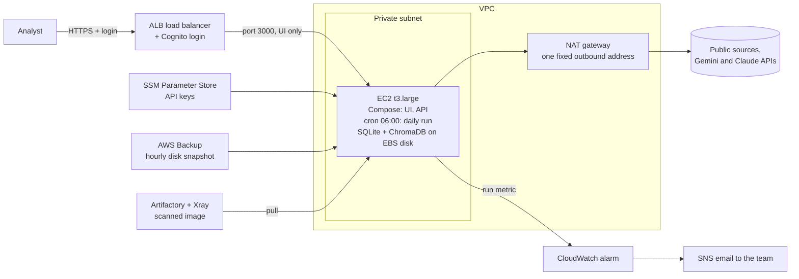
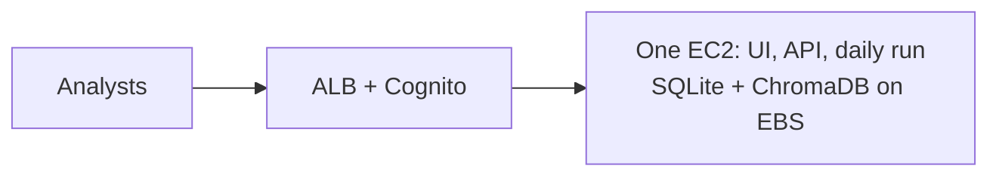
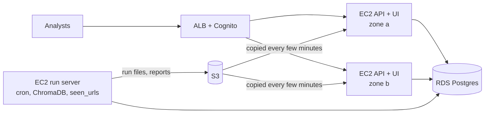
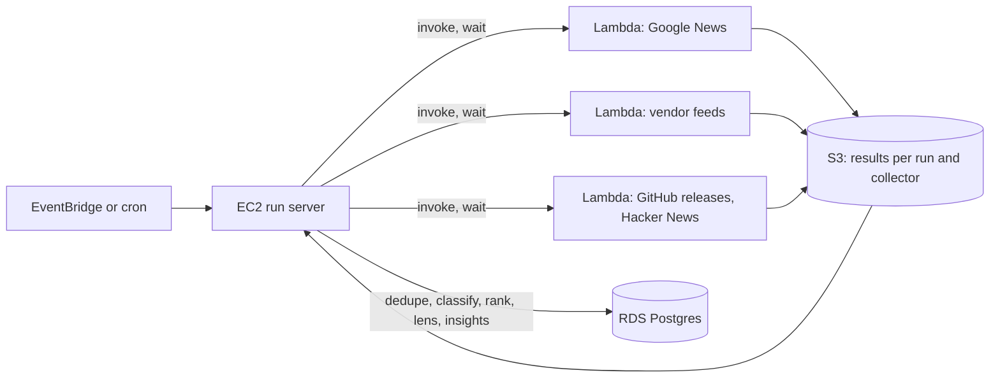

# Architecture

Two parts:

1. **[How Jessi works today](#part-1-how-jessi-works-today)**: what runs now, from the code.
   **Runs today.**
2. **[Production on AWS](#part-2-production-on-aws)**: a design only. **None of it is built or tested for Jessi.**
   The submission runs on one Raspberry Pi and with `docker compose up --build`.

Decision IDs (Dnn) refer to [DECISIONS.md](DECISIONS.md) and the project's internal decision log, which is not in this repo.

---

## Part 1. How Jessi works today

> **Status: Runs today**, on one Raspberry Pi. The demo runs the same API and UI with `docker compose up`.

Jessi is a GenAI pipeline with fixed steps, validation and human review. `run_daily()` in `ci/daily.py` calls the
steps in order, in plain Python: collect, store, classify, rank, validate and route, lens, then insights if enabled.
Thread pools run only during collection. LangGraph is imported only in `modules/graph.py`, used by the legacy
newsletter path; `ci/` does not use it (D117).

### 1.1 Flow

```mermaid
flowchart TD
  subgraph Daily["Daily run, 06:00 Israel time: ci/daily_cron.sh -> python -m ci.daily"]
    C[Collectors in parallel<br/>Google News, vendor feeds,<br/>GitHub releases, Hacker News] --> U[URL dedupe<br/>seen_urls.sqlite]
    U --> F[Full text<br/>fetch + extraction check]
    F --> E[Embedding dedupe<br/>ChromaDB, CVE-ID veto]
    E --> S[(ci.sqlite)]
    S --> CL[Classify<br/>rules for safe cases, then Gemini]
    CL --> R[Rank<br/>Gemini, rubric v2]
    R --> V[Validate<br/>schema + config lists]
    V --> L[JFrog lens<br/>quote checked against the sheet]
    L --> I[Insights<br/>claims quote their sources]
    V --> S
    L --> S
    I --> S
  end
  subgraph Changes["Change detection: ci/changes_cron.sh -> python -m ci.changes --live"]
    P[Tracked pages<br/>fetch + hash] --> X[Gemini extraction<br/>only on new or changed pages]
    X --> CS[(changes.sqlite)]
  end
  S --> API[FastAPI, ci/api<br/>routing derived per autonomy level]
  CS --> API
  API --> UI[Next.js UI, frontend/<br/>Brief, Competitors, Review, Log, Health, Roadmap]
  A[Analyst] --> UI
  UI -->|actions| API
```

Routing is not a pipeline step that writes a status. The API derives each item's status from its stored outputs,
the hold reasons and the current autonomy level (`ci/route.py`); analyst decisions override it (`item_state`).

### 1.2 What each component does

| Component | Code | What it does | Decision |
| --- | --- | --- | --- |
| Schedule | `ci/daily_cron.sh`, `ci/changes_cron.sh` | Host cron at 06:00 Israel time runs the daily run, then change detection, then `ci.reliability make`. The scripts call the host's Python environment (`.venv`), not Docker | D21 |
| One run at a time | `ci/runlock.py` | A file lock per job | — |
| Collectors | `ci/collectors/` | Pull items from Google News queries, vendor blogs and changelogs, GitHub releases and Hacker News, in parallel. One broken collector cannot stop the others | D10 |
| Dedupe | `ci/dedupe.py`, `ci/pipeline.py` | Drops URLs already seen, then near-duplicates by embedding similarity. Two items that name different CVE IDs are never merged | D6, D38 |
| Full text | `ci/pipeline.py`, `modules/reader.py` | Fetches the page and records whether extraction worked, and why not (for example a Cloudflare challenge). Up to 6,000 characters are stored | D39, D57 |
| Classify | `ci/classify.py` | Competitor, one of 7 categories, noise, and the Mentions JFrog flag. Rules settle only the safe cases; the rest goes to Gemini | D11, D24, D25 |
| Rank | `ci/rank.py` | Scores 1-5 on rubric v2 (`config/rubric_v2.md`): competitive impact on JFrog | D14, D29 |
| Validate | `ci/validate.py` | Every model answer is checked: score, competitor and category from the config lists, known item ids. A rejected answer is logged and its item goes to review | D32 |
| Test-split guard | `ci/daily.py` | Items in the golden-set test split skip the model; without the split file the run stops before any LLM call | D23 |
| JFrog lens | `ci/lens.py` | For each non-noise item: the closest JFrog capability axis and a phrase quoted word for word from `config/jfrog_capabilities.md`, checked in code. It never changes a score | D42, D58 |
| Insights | `ci/insights.py` | Patterns across at least 2 stories over a 7-day window (14 with fewer than 15 stories). Every claim must quote its cited article, checked in code. Off on a fresh store until `insights_enabled` is set | D37, D50 |
| Run record | `ci/run_metrics.py`, `ci/run_meta.py` | One `run_metrics` row per run, ok, degraded or failed, with its commit, fingerprints and counts | D48, D59 |
| Change detection | `ci/changes/` | Hashes tracked pages; on a new or changed page, Gemini re-extracts the head-to-head cell. Values are unverified and captioned as such | D13, D88 |
| Routing | `ci/route.py` | Hold reasons × three autonomy levels (Strict, Balanced, Relaxed) decide auto-publish or review | D9, D34, D36 |
| API | `ci/api/` | FastAPI over the store. Accepts only known Host names and refuses cross-site writes (`ci/csrf.py`). Binds 127.0.0.1 | D36, D59 |
| UI | `frontend/` | Next.js. Five screens plus the Roadmap | D3, D21 |
| Demo | `ci/demo.py`, `demo/snapshot/` | Serves the frozen 1 Nov snapshot with no key. Each start copies it to a temporary folder; actions write only there | D2, D69, D111 |
| Reproducibility | `ci/repro.py`, `repro/` | Recomputes every reported eval number from saved reports, with no model call | D59 |
| Fingerprints | `tools/lock_check.py` | Proves the measured prompts, rules and config are unchanged | D59, D99 |

**Runs today, on the Pi**

| Part | What runs | Decision |
|---|---|---|
| Schedule | Host cron at 06:00 Israel time: `ci/daily_cron.sh` (the daily run), `ci/changes_cron.sh` (change detection), then `ci.reliability make`. The scripts call the host's Python environment (`.venv`), not Docker | D21 |
| Pipeline | Plain Python: `run_daily()` calls the steps in order, collect → dedupe → full text → classify (rules first, then Gemini Flash) → rank → route → JFrog lens → insights. Collection uses thread pools. It does not use LangGraph | D5, D25, D117 |
| One run at a time | A file lock per job (`ci/runlock.py`) | — |
| Store | SQLite files on the Pi's disk: `ci.sqlite`, `changes.sqlite`, `seen_urls.sqlite`. ChromaDB, also on disk, holds the dedupe embeddings and is used only by the run, never by the API | D6 |
| Live API and UI | They run outside Docker: `python -m ci.api --port 8011` and `next start` on port 3017, both on 127.0.0.1 | D3 |
| Demo | `docker compose up` serves a frozen snapshot with no API key. Actions write to a temporary copy. The Compose `api` and `ui` services are demo-only | D2, D111 |
| Access | SSH tunnel or Tailscale. No user login | — |
| Safety on the API | The API accepts only known Host names (`TrustedHostMiddleware`, against DNS rebinding) and refuses cross-site writes (CSRF guard). Both live in `ci/csrf.py` | D59 |
| Backups | A file copy before any write to the live store | — |
| LLM keys | In `.env` on the Pi | — |

Limits of this setup: it is one machine, and a missed run alerts nobody. It shows on the Health page only when someone opens it.

### 1.3 Data model

Three SQLite files under `data/ci/`, plus ChromaDB for dedupe embeddings. Table names and columns are from the
stores' schemas; checked on 4 Nov, the live `ci.sqlite` has 14 tables and 1,916 rows, and `changes.sqlite` 5 tables
and 114 rows (D115).

**`ci.sqlite`: items and everything decided about them**

| Table | One row per | Holds |
| --- | --- | --- |
| `items` | collected item | URL, source, prefilled competitor, title, `published_at` (feed date), `discovered_at`, the first run, the raw item |
| `sightings` | item × run | each run that saw the item again |
| `runs` | run | kind (daily or import), start, processing and finish times, status (running, ok, degraded, failed), fingerprint, model, error, report |
| `run_metrics` | run | status, fingerprints (classify_rank, lens, insights) and the counts Health shows |
| `classifications` | item × run | competitor, category, noise, Mentions JFrog, confidence, method (rules, LLM or fallback), degraded, fingerprint |
| `rankings` | item × run | score, raw score before code adjustments, noise, degraded, needs review, fingerprint |
| `skips` | item × run | why the model was not called (for example the golden-set test split) |
| `rejections` | rejected answer | item, run, stage (classifier, ranker, output) and reason (D32) |
| `lens` | item × run | status (ok, rejected, failed), axis, capability quote, relation, why, reason |
| `insights` | generation | Brief date, trigger (daily or refresh), level, status, fingerprint, model, the insights and their window. Every generation is kept; the latest is shown |
| `item_state` | item | the analyst's decision (approved, dismissed), the flag, edits to competitor, category or score. Routing is derived; this only overrides it |
| `analyst_actions` | action | append-only history: approve, dismiss, edit, flag, unflag, trust, untrust, with before and after values (D62) |
| `trusted_sources` | host | sources an analyst trusted, on top of `config/vetted_sources.yaml` (D34) |
| `settings` | key | the autonomy level, `insights_enabled` |

**`changes.sqlite`: tracked pages and head-to-head cells**

| Table | Holds |
| --- | --- |
| `snapshots` | each tracked page's URL, hash and fetch time |
| `cells` | the current head-to-head value per competitor × axis, with evidence, source URL, as-of date, stale and review flags |
| `cell_history` | every earlier value of a cell, with the run and the change |
| `changes` | each detected change, published as an item |
| `change_state` | an analyst's decision on a change |

**`seen_urls.sqlite`** holds every URL already collected, so a later run skips it.

**Config files** (`config/`): `competitors.yaml`, `rubric_v2.md`, `jfrog_capabilities.md` (the capability sheet the
lens and insights quote), `vetted_sources.yaml`, `tracked_pages.yaml`, `brief.yaml`.

---

## Part 2. Production on AWS

> **Status. Design only: none of it is built or tested for Jessi.** The submission runs on the Pi and with
> `docker compose up --build`. Source: the approved AWS production design (D116). Section 1 of that design, what
> runs today, is in Part 1 above; sections 2 to 7 follow here with their numbers.

Jessi's workload is small. The source for every number in this paragraph is `run_metrics` in the live store (`data/ci/ci.sqlite`), read on 4 Nov 2026.

- **Run size.** A daily run collected 237–258 items, and 13–46 of them were new and sent to the model (n = 5 daily runs, 31 Oct to 4 Nov).
- **LLM calls.** Gemini calls per run, as counted by `CountingLLM` in `ci/daily.py`, were 5–13 (n = 4, 1 to 4 Nov; the 31 Oct run did not record the count). Claude judge calls, if any, are not in that count.
- **Run time.** A run took 2.7–6.2 minutes from start to finish (n = 5).
- **A fresh store is much heavier.** The first import sent 256 items to the model, against 13–46 on a normal day. That run did not record its LLM calls, and its 24-hour span between start and finish is not a run time. A clean clone on 4 Nov collected 169 items and stored 135, and with no key it wrote fallback rows for 128 of them (19:52). That no-key run counted 37 attempted LLM calls (n = 1). None of them reached a model API, so they are attempts, not real calls, but they show the scale against 5–13 on a normal day. So a first run on an empty store sends several times more items to the model, and makes several times more calls, than a normal day.

So size S, the first production deployment, moves today's stack onto one EC2 instance and changes no Python or frontend code, as far as checked. It does need the configuration and script changes listed in section 2.1. Each later step starts when a stated trigger is reached.

### 2. Moving to production (design only, not built)

#### Size S: the first production deployment

#### 2.1 Changes needed to move to production (none of it built)

The application code stays as it is. These configuration and script changes are still needed:

| # | Change | Why it is needed | Kind |
|---|---|---|---|
| 1 | A production Compose file for the live system: the API without `CI_DEMO_DIR`, with the data, output and evals folders mounted, and the Gemini key in its environment (Refresh insights calls Gemini). The UI is built for live use instead of `CI_MODE=demo` | Today's Compose `api` and `ui` serve only the demo, and the live system runs outside Docker | Configuration |
| 2 | Publish the UI's port on the instance's private address, not 127.0.0.1. Only the ALB may reach it (security group). The API port is not published at all | Compose publishes the UI on 127.0.0.1:3000, and a load balancer cannot reach a loopback address | Configuration |
| 3 | Check in the shadow week that the API still sees the Host `api` behind the ALB, and add the ALB's domain to `CI_TRUSTED_HOSTS` only if it doesn't | The browser talks only to the UI, and the UI's server forwards `/api/v1/*` to `http://api:8011`. The demo Compose already trusts `api` for that hop. The hop is expected to keep that Host, but it has not been tested behind an ALB | Verify, maybe configuration |
| 4 | No change to the CSRF guard | Behind the ALB the browser still sends `Sec-Fetch-Site: same-origin`, which the guard accepts (checked in `ci/csrf.py`) | — |
| 5 | Cron calls the pipeline inside the image (`docker compose run --rm` with `ci.daily`, `ci.changes --live` and `ci.reliability make`). That needs new Compose services or entrypoints | Today's cron scripts call the host's `.venv`. The server is meant to have no build tools, and Compose's `ci` service runs only collection (`ci.run`) | Configuration and script |
| 6 | A start script that reads the keys from Parameter Store and passes them to the containers | Keys move out of `.env` | Script |
| 7 | An addition to the cron script that sends a success metric, or a failure metric when the run fails or ends degraded (exit 3), to CloudWatch | The alarms need it | Script |
| 8 | Install and configure the CloudWatch agent for the logs | Logs reach CloudWatch | Configuration |
| 9 | An HTTPS listener on the ALB, with a certificate and a domain name (section 2.2) | The ALB checks a Cognito login only on HTTPS | Configuration |

Not covered by size S: the app has no users, so even behind a login, the Log does not record who approved or dismissed an item. Recording it would mean reading the ALB's identity header, which is a code change.

#### 2.2 Components

| Component | Choice | What it does, and why over the simpler option |
|---|---|---|
| Server | One EC2 **t3.large** (2 vCPU, 8 GiB) with a 30 GB gp3 disk (EBS). Use t3a.large if it is cheaper in the chosen region | It runs the Compose stack and cron in one place, like the Pi does. The target is x86_64: the Pi's ARM processor came from developing on a Pi, not from a decision. The full stack, including ChromaDB and its native libraries, is built and checked on AMD64 during the shadow week. Memory, CPU credits and run time are watched before any resize |
| Store | SQLite and ChromaDB on the instance's disk (EBS) | This keeps the riskiest code change out of size S. SQLite-specific SQL sits in 9 files, and the demo must stay on SQLite either way |
| Load balancer | **ALB** | **What it does:** it receives every request from the browser and passes it on to the server. **Why:** the simpler option is to give the server a public address, but then the server is exposed to the internet, and nothing checks a login before the app |
| Login | **Cognito** | **What it does:** it is AWS's user directory and login page, and the ALB asks it whether the user is signed in before any request reaches the app. **Why:** the simpler option is to write a login into the app, but that is new security code to own, and Cognito can later hand off to JFrog's own identity provider |
| HTTPS certificate | A TLS certificate on the ALB, issued and renewed by AWS Certificate Manager (design only) | **What it does:** it proves to the browser that the site is really ours and encrypts the traffic between the browser and the ALB. **Why it is needed:** the ALB runs the Cognito login only on an HTTPS listener, and without encryption the login and the analysts' data would cross the network readable |
| Domain name | A name such as a subdomain under JFrog's internal domain, pointing at the ALB (design only) | **What it does:** it gives analysts a stable address to open instead of the ALB's long generated one. **Why it is needed:** a certificate is issued for a name, and Cognito sends the user back to a fixed address after login, so both need a name we control |
| Network | **Private subnet** | **What it does:** it is a part of the network with no route in from the internet, so the server has no public address. **Why:** the simpler option is a public subnet with a locked security group. That works, but one wrong rule would expose the server, while a private subnet cannot be reached from outside at all |
| Outbound | **NAT gateway** | **What it does:** it lets servers in the private subnet open connections out to the internet, which the run needs for fetching pages and calling the LLMs, while nothing can connect in. **Why:** the simpler option is a public address on the server, which saves about $35 a month (unverified estimate, section 7), but loses the private subnet's protection. All fetches also leave from one fixed address, which shows quickly if sites start blocking us |
| API keys | **SSM Parameter Store** | **What it does:** it stores the keys encrypted, and only the instance's IAM role is allowed to read them. **Why:** the simpler option is `.env` on the disk, as on the Pi, but then the keys sit in every hourly snapshot. Secrets Manager adds automatic rotation, but these API keys can't be rotated automatically anyway |
| Admin shell | **SSM Session Manager** | **What it does:** it opens a shell on the server from the AWS console or CLI. **Why:** the simpler option is SSH through a second public server, but that means an open port 22, SSH keys to manage and one more server to patch. Session Manager needs none of that, and it logs every session |
| Backup | **AWS Backup** | **What it does:** it runs a backup plan that takes a snapshot of the whole disk every hour and deletes old ones. A snapshot is a full copy of the disk at that moment, so SQLite, ChromaDB and the run files are all covered. **Why:** the simpler option is a cron line that calls the snapshot command, but that is code we own, and it stops if the instance dies. In size M the same plan can back up RDS. A snapshot of a running disk behaves like a sudden power cut, and SQLite is built to recover from that |
| Alerts | **CloudWatch** alarm, then **SNS** email | A run that starts and fails alerts at once, through its own failure metric. A degraded run (exit 3) alerts the same way, because a degraded morning means a Brief built partly on fallback rows. A second alarm fires when the success metric has been missing for 26 hours, meaning a run never started or never finished. That alarm also covers the whole instance going down. Design only: the metric is not sent today |
| Deploy | Build once, scan with **Xray**, push to **Artifactory**, then the server pulls the image and runs it | Requirement: everything running in production has been scanned. Choice: Artifactory and Xray rather than ECR, because the scan and the registry sit on one platform. This is a design and has not been built for Jessi. The scan and push steps were run in Stage 2 on the forked app. Jessi's submission runs with `docker compose up --build` |
| LLM | Direct API calls to Gemini and Claude, as today | See section 4 |
| Region | JFrog's standard | The region follows where JFrog's other internal tools run, data-residency rules, and which Bedrock models are available there |

**Stated openly:**
- Up to about one hour of analyst actions (approvals, dismissals, edits) can be lost, because that is the time between snapshots.
- The single EC2 instance is a single point of failure. If it goes down, the alarm reaches a person, and the app is restored from the latest snapshot.

What does not change: prompts, rules, routing, scores, the eval protocol and the D32 prompt-injection guards. The LLM still has no tools.

### 3. Moving from the Pi: a 7-day shadow run (design only, not built)

EC2 runs daily at 06:00 alongside the Pi for 7 days. Each side has its own data store, and the shadow publishes and sends nothing. This tests the move to new infrastructure only. Moving to more frequent collection is a separate change with its own check (section 4).

Acceptance criteria for cutover:

1. Every scheduled run is monitored over 7 consecutive days. No unexplained failures and no unresolved backlog at cutover.
2. Items collected per source stay within 10% of the Pi baseline. Unique URLs are also compared, and material differences are investigated.
3. Overall text extraction is no more than 5 percentage points below the Pi baseline (about 71%, n = 325). Drops for single sources are investigated. AWS addresses may be challenged by Cloudflare more often than a home address, and 5% of items are already blocked from the Pi (D39).
4. No source keeps succeeding on the Pi while failing or staying silent on EC2.
5. Collection and processing finish within the scheduling interval, with enough headroom that runs never overlap.
6. The shadow makes zero external publications or notifications, and modifies no production data.
7. Data integrity, deduplication and the restore procedure are verified before cutover.

Cutover needs all seven criteria, plus confirmation that the Pi can be used for rollback. Data is synchronized before the switch, and the Pi stays as the rollback option for one more week. A shadow started on an empty store would see the much heavier first run described at the top, so it starts from a copy of the Pi's store.

### 4. How it grows (design only, each step triggered)

Section 5 turns these triggers into three sizes.

| Trigger | Change |
|---|---|
| We need more than one API instance, or a loss window smaller than one hour | **Size M: RDS Postgres** for the store. The API instances read only RDS, because only the run uses ChromaDB. The port touches the 9 files with SQLite SQL, and the demo keeps SQLite. Before cutover, old and new code must return identical responses on a copy of the live store, the same proof as D111 |
| More sources or competitors | The run stays on EC2. It mostly waits on web pages and the LLM, and the collectors are already parallel, so growth means a larger instance or more parallel fetches. Revisit only if a run passes about an hour |
| Fresher items: hourly or continuous collection | This is the intended future direction, not a size S requirement. A separate short check at hourly frequency comes first: overlapping runs, incremental processing, source rate limits, backlog and cost. The Brief still forms once a day, and the missed-run alarm window drops from 26 hours to about 2. Items sent to the model grow with new items, not with runs, because URLs already seen are skipped |
| LLM provider | Preferred long-term direction: **Amazon Bedrock**, subject to JFrog's AI infrastructure and security policies, for managed infrastructure, access through IAM and central governance. Size S keeps direct calls to keep the move small. The LLM clients are created in one module (`modules/llm_clients.py`), and the provider-specific calls sit in three files (`ci/llm.py`, `modules/nodes.py`, `modules/judge_llm.py`), so a switch touches those four files. Gemini's results so far are preliminary and not checked against analyst-reviewed ground truth. Any model change is validated on a representative, analyst-reviewed evaluation set first |
| Readers beyond analysts (D19) | Slack, email and the usual news feeds, as agreed with the CI team |

**Not built:** add agents for small, bounded processes inside the pipeline (D118).

Left out of the design: Kubernetes, ECS and Step Functions, because they could not be defended for this workload
(D116).

### 5. Sizes S, M and L (design only, not built)

**What the code shows first.** Per-step timings in `run_metrics` (n = 4 daily runs, 1 to 4 Nov) put collection at 56–63 seconds a run. Classify, rank and lens took 70–275 seconds together, and insights 35–46 seconds. So the slow part today is the LLM work, not the fetching.

Two more facts shape M:
- **The API reads files as well as the store.** It reads run files (`output/runs/*.jsonl` and `*.dropped.jsonl`, used for the Log's dropped items and for coverage), eval reports in `evals/`, change reports in `output/changes/`, and `changes.sqlite`. It also writes the analysts' candidate labels to `evals/analyst_labels.jsonl` and its log to `output/logs/`.
- **Only the run reads the ChromaDB store,** but the API image still loads Chroma's embedding model (`ci/dedupe.py: default_embedding_fn`) for Refresh insights. That model runs inside the API, so it needs no shared data, but the library stays in the API image.

| | **S** | **M** | **L** |
|---|---|---|---|
| Shape | One EC2 does everything | Several API servers, one run server, a shared database | Collection fanned out to Lambdas, processing on the run server |
| Store | SQLite and ChromaDB on one disk | RDS Postgres. ChromaDB and `seen_urls` stay on the run server's disk | Same as M |
| Run | Cron on the single server | Cron on its own run server | The run server still drives the run. It calls one Lambda per collector and waits for them |

#### Size S: the first production deployment, as in D116

**Trigger:** moving off the Pi. One team uses the system, and a daily run is enough.

**Components:** sections 2 and 3, unchanged. The diagram is in section 2.

**What changes:** see section 2.1, all design only, not built.

**Why this is enough, and the main risk:** today's whole run takes a few minutes on one small machine, so one server covers one team. The main risk is that the server is a single point of failure, with up to about an hour of analyst actions lost.

#### M: several API servers, a separate run server, RDS

**Trigger:** any of these needs, stated in words because no traffic number exists yet. The UI must stay up when one server fails or during a deploy. The loss window must be smaller than about an hour. Or the morning run must stop slowing the API that analysts are using.

**Components:**
- The ALB with Cognito, as in S.
- Two EC2 API servers (UI and API) in two availability zones, both registered with the ALB.
- One EC2 run server, with cron, the ChromaDB store and `seen_urls.sqlite` on its disk.
- RDS Postgres for `ci.sqlite` and `changes.sqlite`.
- S3 for run files, eval reports and change reports.
- AWS Backup, now covering RDS and the run server's disk.

**What changes from S:**
- The API and the run move to separate servers.
- The store moves to RDS, and the API servers no longer keep any data of their own.
- Restore goes to the minute (RDS point-in-time restore) instead of the last hourly snapshot.

**What stays:** the ALB and Cognito, the private subnet and the NAT gateway, Parameter Store, Session Manager, the alarms, the deploy path, the LLM calls, the pipeline code, and the demo on SQLite.

**What must change, as far as checked. All design only, not built:**

| # | Change | Why | Kind |
|---|---|---|---|
| 1 | Port `ci.sqlite` and `changes.sqlite` to Postgres. SQLite-specific SQL sits in 9 files. The demo keeps SQLite, so the code needs both. Before cutover, old and new code must return identical responses on a copy of the live store (as in D111) | Two API servers cannot share a SQLite file | Code |
| 2 | The run server uploads run files and reports to S3 after each run. Each API server copies them down every few minutes with `aws s3 sync`, so the API code keeps reading local files | The API reads these files from disk (Log, coverage, Health). The cost is a delay of a few minutes after a run | Script |
| 3 | Candidate labels move from `evals/analyst_labels.jsonl` to a table in Postgres | With two servers, an Edit would land in a file on whichever server handled it | Code |
| 4 | A lock around Refresh insights, held in Postgres. Postgres has a built-in named lock that only one session can hold at a time | The API takes no lock for Refresh insights today. With two servers, two refreshes could run at once | Code |
| 5 | The run lock stays a file lock on the run server | It holds as long as there is exactly one run server | — |

**Why this is enough, and the main risk:** the API servers keep no data of their own, so either one can fail without losing the UI. The run still takes minutes on a single server. The main risk is the store port: 9 files, two storage backends, and a proof needed before cutover.

**Cost:** about $250–300 a month, an unverified estimate from memory. M runs three EC2 servers (two API, one run) where S runs one, and adds RDS and S3.

#### L: collection fanned out to Lambdas

**Trigger:** a need for much more collection, such as many more competitors and sources, hourly collection, or isolating one source's failure from the others. On one server, collection must then stop fitting the scheduling interval. That is not the case today: collection takes about a minute (n = 4), and the LLM steps take longer.

**Challenge to the starting point.** Splitting collection helps only once collection is the slow part, and today it isn't. The work that grows with volume is the LLM work and dedupe. Dedupe needs the ChromaDB store and all items together, and insights need all items too. So L splits only collection, and processing stays on the run server.

**Components:**
- Everything in M.
- One Lambda per collector. Each collector already has the same entry point, `collect(cfg, since)`, in `ci/collectors/`: Google News, vendor feeds (which also read the listing pages), GitHub releases and Hacker News.
- S3 for each collector's results.
- EventBridge Scheduler, which starts the run server's job in place of cron. That is optional, because cron can stay.

**How the steps are coordinated, with no new service.** The run server is already a Python process that runs the steps in order. In L it calls the collector Lambdas in parallel and waits for each answer. Each Lambda writes its items to S3 and returns only the S3 key, because a direct answer is limited to a few MB. Then the run continues as today. A collector that fails or times out shows as a silent source, which Health already reports. The run goes on without it.

**The 15-minute Lambda limit.** Today all collection takes about a minute, but time per collector is not recorded, so per-collector headroom is unknown. If one collector nears the limit, it is split by competitor, with one Lambda per collector and competitor. The run server has no such limit.

**What changes from M:**
- Collection moves to Lambdas.
- Collector results land in S3 before processing.

**What stays:** processing, dedupe with ChromaDB, the store, the API servers, and the whole front of the system.

**What must change, as far as checked. All design only, not built:**

| # | Change | Why | Kind |
|---|---|---|---|
| 1 | A small Lambda handler per collector that calls the existing `collect(cfg, since)`, writes the result to S3 and returns the key | Each collector becomes its own unit | Code |
| 2 | The run's collect step invokes the Lambdas in parallel and reads their results from S3, instead of calling the collectors in its own thread pool | Coordination stays inside the run, so no new service is needed | Code |
| 3 | The Lambdas run in the private subnet and go out through the NAT gateway | Fetches keep the one fixed outbound address. Lambdas outside the network would use changing AWS addresses, and Cloudflare blocks are already 5% (D39) | Configuration |
| 4 | Record time per collector in `run_metrics` before moving, to measure the 15-minute headroom | Only the total for collection is recorded today | Code |

**Why this is enough, and the main risk:** collectors run side by side without limit, and one failing source cannot block the others, while the steps that need all items stay together on one server. The main risk is that the run server becomes the limit, because LLM work and dedupe grow with new items. The next subsection addresses that risk.

##### Addressing the run-server limit (design only, not built)

**Today.** Classify, rank and lens each send their items to the model in batches of 10 (`BATCH_SIZE` in `ci/classify.py`, `ci/rank.py` and `ci/lens.py`). The batches go one at a time in a plain loop. Those three steps took 70–275 seconds of each run (n = 4), and almost all of that is spent waiting for the API.

**Are the batches independent? Yes, checked in the code:**
- **Each prompt is built only from its own batch.** No batch reads another batch's answer. The ids in an answer are matched only against the ids sent in that batch.
- **Each batch fails on its own.** A failed batch gives fallback rows (classify), review items (rank) or failed lenses (lens) for its own items, and the run goes on.
- **Results are merged by item id.** The output order does not depend on which batch finishes first: classify and lens return items in input order, and rank sorts its output with `order()`.
- **The steps still depend on each other.** Rank needs the classifications, and lens needs the rankings. So the steps stay in order, and only the batches inside one step run in parallel.

**What must change first, all in code:**

| # | Change | Why |
|---|---|---|
| 1 | Run the batch loop in `ci/classify.py`, `ci/rank.py` and `ci/lens.py` through a small thread pool, like the one collection already uses (`ci/pipeline.py`). Merge the results in batch order | The calls then wait for the API side by side instead of one after another |
| 2 | Put a lock on the call counter (`CountingLLM.calls` in `ci/daily.py`) and on the rejection list (`ValidatingLLM.rejections` in `ci/validate.py`) | Both are shared by every batch and updated without a lock today. In parallel, the counter could miscount and the rejections could come out in a changing order |
| 3 | Keep the per-step timings and call counts in `run_metrics` | They are taken around the whole step (`ci/run_metrics.py`), so they still hold, but they are the only way to measure whether the change helped |

**What prevents doing it today: the fingerprints, not the code.**
- The classify-and-rank fingerprint hashes the full source of `ci/classify.py` and `ci/rank.py` (`ci/eval_golden.py: fingerprint`), and the lens fingerprint hashes all of `ci/lens.py`. So even a change that leaves the prompts and the outputs alone changes the fingerprints, and the reported numbers would no longer match the code that runs.
- **Before release,** prove that the output is identical: feed the same recorded model answers to the old and the new code, and compare the classifications, rankings and lenses, the same kind of proof as D111. Then record the new fingerprints as a new version. The frozen submission stays as it is.

**Next step, only if measurements show the first is not enough:** run the batches in Lambda. The run server starts them in parallel and waits, the same way as the collectors in L. Each Lambda writes its answers to S3 and returns the key, and the run server merges them by item id. This uses no new service. The Lambdas need the API keys from Parameter Store and go out through the NAT gateway.

**What stays central:** dedupe and insights stay on the run server, in one process. Dedupe compares every new item with all earlier items in the ChromaDB store. Insights group items across competitors and need every item in the window.

**The remaining limit: the model provider's rate limits.** Parallel batches reach the provider's per-minute limits sooner. The client already retries a 429 or 5xx answer: one call plus two retries, waiting longer each time, with a random spread so parallel callers don't retry together, and honouring the server's requested wait up to 60 seconds (`ci/llm.py`). A batch that still fails falls back as described above. So the number of parallel batches has to be set below the account's quota. That quota is not known here, and it differs by provider and by account.

**A new service would be needed only if** the collectors had to start and finish without the run server driving them, for example on their own schedules with a step that waits for all of them. That needs a coordinator such as Step Functions or a queue, and it is not proposed. L as written needs none.

**Cost:** left out. It depends on volumes that don't exist yet.

### 6. Serving more teams (design only, not built)

**Principle:** one shared pipeline and one source of truth, with a different view for each team. There is no separate pipeline per team.

**What exists today, checked in the code:**
- **One analyst group with no user identity.** `analyst_actions` stores the action, reason, note and time, but there is no column for who acted. So nothing records who approved an item.
- **One review queue and one autonomy level** for all items. The level is set through `/api/v1/settings/autonomy-level`.
- **One competitor list, one rubric and one golden set:** `config/competitors.yaml`, `config/rubric_v2.md` and `evals/golden_set.jsonl`. The list of trusted sources is also shared by everyone.
- **No delivery outside the UI.** There is no Slack, email or MCP code in `ci/`.

**What each team would need:**
- **Identity and permissions.** The app knows who the user is from the login (Cognito, behind the ALB) and what they may do: read, act on items (approve, dismiss, edit), or change settings.
- **A team view.** A profile with the team's competitors and categories, which filters the Brief, Competitors and Log screens. The Log can already filter by competitor and category.
- **Updates where the team works (D19).** Role-based digests built from the same Brief, sent by Slack, email or the usual news feeds as agreed with the CI team. Later, a read-only internal MCP server over the same API.

**What stays central, so numbers never conflict:** collection, dedupe, classification, scoring, routing and the evaluation. Each item has one classification and one score for everyone. A team view hides items but never re-scores them. Approval stays in one review queue, because an approved item is published for every team.

**Who owns what. This is a proposal to agree with the teams, not a fact:**

| What | Proposed owner | Who may change it |
|---|---|---|
| Competitor list and vetted sources | The CI team | The CI team. Other teams ask for additions |
| Rubric and routing rules | The CI team, with product experts | The CI team, only after an eval on the train split (D23) |
| Golden set and evaluation | The CI team | The CI team. Analyst edits stay candidates until merged (D31) |
| Autonomy level and review queue | The CI team | The CI team's lead |
| A team's view and digest | That team | That team |

**Order to add these, each started by a need. Code changes as far as checked:**

1. **The first reader outside the CI team.** Read the user from the ALB's login header, add a user column to `analyst_actions`, and limit write routes to analysts. This is code and one column.
2. **A team wants only its competitors.** Add a table of team profiles and filter the screens' queries by profile. The data itself is unchanged. This is code and one table.
3. **A team wants updates without opening the UI.** At the end of the daily run, build one digest per profile from the same Brief and send it on the agreed channel. This is code in the run.
4. **Teams want to ask questions directly.** A read-only MCP server over the existing API, on the API servers. This is new code, not a new AWS service.

Not proposed: scoring, approval or a pipeline for each team. Each of these would create a second source of truth.

### 7. Rough monthly cost of size S (unverified estimate)

**Unverified estimate, from memory of on-demand list prices.** Nobody checked these figures against AWS pricing or ran a quote. Check them with the AWS Pricing Calculator for the chosen region before quoting any of them.

| Item | About |
|---|---|
| EC2 t3.large | $60 |
| NAT gateway | $35 + data |
| ALB | $20 |
| Disk (30 GB) and hourly snapshots | $5 |
| CloudWatch, SNS, Parameter Store, Cognito (a few users) | under $5 |
| LLM calls on a normal day | a few dollars |
| **Total** | **about $125, unverified** |
