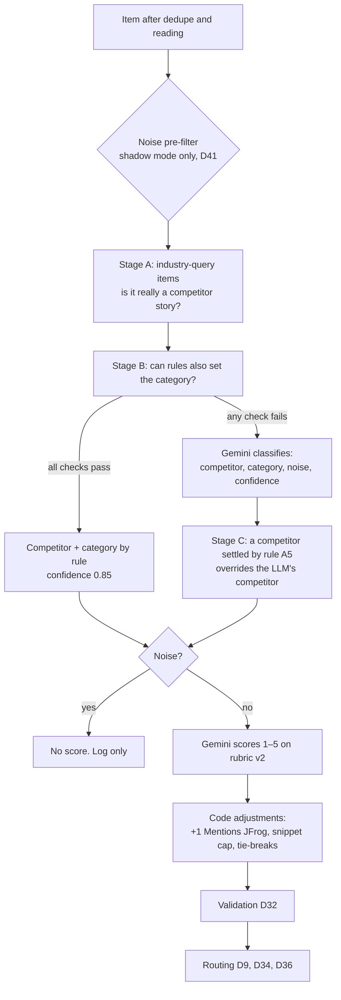

# Jessi rules: classify, category and ranking (DRAFT, 2 Nov 2026)

What decides each item's competitor, category, noise flag and score. Text is taken from the PRD (decision IDs given)
and from the files the pipeline actually reads at `main` ae8fbb5. Where the code holds the exact wording, the code's
wording is quoted, because that is what runs. Differences between the PRD and the code are listed at the end and in
`GAPS_AND_QUESTIONS.md` (c20, c22–c24).

All of these rules are **frozen** since 31 Oct (D41, D57). The classify and rank prompts, rules and the rubric file
are hashed into the `classify_rank` fingerprint (99b79890ceea); changing any of them changes the fingerprint and
would void the test-split eval (D23, D66).

## 1. Order of decisions for one item

Rules only ever **settle** a competitor or category when they are certain. No rule discards an item: "the default is
'run the LLM'; rules only skip it when they are certain" (D25).

---

## 2. Classify rules: which competitor

**Scope (D10).** Cloudsmith, Sonatype, GitHub, GitLab, Snyk, AWS, plus an **Industry** channel (supply-chain attacks,
AI-agent and MCP security). The list lives in `config/competitors.yaml`. An item about none of them, and not such
industry news, gets competitor "none".

### Stage A: items found by an industry query (PRD, Competitor tagging rules)

| # | Check | Outcome | Example title |
| --- | --- | --- | --- |
| A1 | Not prefilled industry | Skip to Stage B | "Cloudsmith adds npm provenance checks" (Cloudsmith query) |
| A2 | Market chatter, marketing or roundup title | Stays industry, LLM decides | "GitLab stock rallies after earnings" |
| A3 | No tracked competitor in the title | LLM, as industry | "Malicious npm packages steal developer tokens" |
| A4 | Two or more competitors in the title | LLM, as industry | "GitHub and GitLab patch the same Ruby flaw" |
| A5 | Exactly one, and it is the subject: name + strong verb (not followed by ":"), or possessive + product word | Competitor settled by rule; category and noise still decided later | "GitHub Launches npm Firewall…", "GitHub's npm firewall can block…" |
| A6 | Exactly one, but not the subject: a venue, a weak verb, "verb:" or a mid-title mention | LLM with hint "company or platform?"; industry is the fallback | "Hackers Hide Malware in 42 GitHub Repositories", "GitHub's repositories abused…" |

### Stage B: items with a competitor; can rules also set the category?

| # | Check | Outcome | Example title |
| --- | --- | --- | --- |
| B1 | Competitor is industry or none | LLM | any remaining industry item |
| B2 | Chatter, marketing or roundup title | LLM | "Snyk UNFILTERED summit recap" |
| B3 | A rival dominates the mentions (a title mention counts ×3) | LLM | a Sonatype-query item mostly about Snyk |
| B4 | Title also names another competitor | LLM | "Sonatype and Snyk both flag new PyPI malware" |
| B5 | Competitor not in the title, and the source is not its own feed, listing or repo | LLM | "New Maven Central trust controls" |
| B6 | No category keyword, or several (exception: its own GitHub release is Product & Features) | LLM | "GitHub Copilot Fusion: route and orchestrate models" |
| B7 | Everything passes | Competitor + category by rule, confidence 0.85 | "Cloudsmith: Deprecating Trivy vulnerability scanning" (own changelog) |

### Stage C: after the LLM

A competitor settled in A5 overrides the LLM's competitor.

### The word lists behind A5 (from `ci/classify.py`)

- **Strong verbs (subject case):** launch, add, introduce, unveil, announce, release, acquire, preview, debut, expand,
  update, ship, roll out, patch, fix, in their common forms. None counts when directly followed by ":" ("GitHub
  updates: attackers…" is not settled). Weak verbs (make, bring) were removed. Verbs for funding, pricing and
  leadership (raises, partners, cuts, appoints) are left out on purpose, so those titles go to the LLM.
- **Product words (possessive case):** Copilot, Dependabot, CodeQL, Advanced Security, Actions, Duo, Orbit, Nexus,
  CodeArtifact, Amazon ECR, Amazon Inspector, "npm firewall", "npm package firewall", "package firewall". This is an
  allow-list, not a list of venues: after "GitHub's", anything that is not a listed product goes to the LLM with the
  hint. Generic words (npm, registry, AI, agent, scanner, MCP, CLI, Packages, bare "firewall") were removed because
  they let a venue settle by rule again; "GitHub's npm registry hit by worm", "GitHub's AI agents leak tokens" and
  "GitHub's MCP server exposed" are pinned as hint cases.
- **Title lead:** a short lead such as "Exclusive:" or "The" before the competitor's name is allowed.

### What the LLM is told about the competitor (classifier prompt, `ci/classify.py`)

- The prefilled competitor is only the search query that found the item and may be wrong.
- Use "industry" for news that matters to JFrog without centering on one tracked competitor (software supply-chain
  attacks, malicious packages, AI-agent and MCP security); use "none" for anything else.
- With the hint "Competitor named in title: <key> — company or platform?", use the key only when the story is about
  the company or its product; when the title names it as the place something happened (malware in GitHub
  repositories), keep "industry".
- `full_text_mentions` gives how often each competitor is named across the whole page, so a listicle that names a
  competitor deep in the text can still be read correctly.
- The model sees the title and the first 1,500 characters of text, inside `<item_text>` tags marked as data (D32, D51).

### Regression tests (D24)

Every title a review or the golden set showed the rules got wrong is pinned as a test with its expected outcome, so a
fix for one title cannot silently re-break another.

---

## 3. Category rules

### The seven categories (D11) and their definitions

One primary category per item. The definitions below are the ones the classifier prompt uses, word for word
(`CATEGORY_DEFINITIONS` in `ci/classify.py`).

| Category | Definition given to the model |
| --- | --- |
| Product & Features | it improves product capabilities, infrastructure, compatibility, performance or interfaces, without security as its central value |
| Pricing & Packaging | prices, plans, tiers, licensing, free-tier or bundling changes |
| AI & Agents | AI features, coding assistants, agents, MCP servers, LLM capabilities in the product |
| Security | the development's central value is detecting, preventing, analyzing or reducing security risk |
| Funding/M&A/Partnerships | funding rounds, acquisitions, mergers, IPOs, strategic partnerships |
| Customers & Market | customer wins, analyst reports, market share, surveys, adoption and market positioning |
| Leadership & Org | executive hires and departures, layoffs, reorganizations |

A cross-cutting **Mentions JFrog** flag sits on top of the category (D11). It is set when the page names jfrog,
artifactory, frogbot or swampup. Bare "Xray" is left out because it is also a proxy tool; URLs and domains do not
count as mentions. Known issue: the match runs over the whole fetched page, not only the stored text (D57).

### Tie-break rules between categories (D40, D41; given to the model word for word)

1. **Security vs Product & Features (D40):** Security when the development's central value is detecting, preventing,
   analyzing or reducing security risk; Product & Features when it improves product capabilities, infrastructure,
   compatibility, performance or interfaces without security as its central value.
2. **Pricing & Packaging (D41):** "a change in price, what's included, tiers, seats or licensing is Pricing &
   Packaging, even when the product is AI."
3. **AI & Agents vs Security (D41):** "a product or capability for AI agents, MCP or models is AI & Agents, even when
   its value is security. An attack on, or a vulnerability in, any tool, AI tools included, is Security."

Why rule 2 exists: "Copilot included in GitHub Enterprise" was classified AI & Agents, so a pricing change skipped
the review that D9 forces on Pricing (D41).

### When rules set the category without the LLM (Stage B6, `ci/classify.py`)

A title must match the keywords of **exactly one** category; zero or several matches go to the LLM. Keywords are kept
narrow on purpose.

| Category | Title keywords (summary) |
| --- | --- |
| Funding/M&A/Partnerships | acquire / acquisition, merger, funding, raises, Series A–F, invest…, partner…, IPO |
| Pricing & Packaging | pricing, price change, per seat, free tier / plan, licens…, subscription, new plan(s) |
| Leadership & Org | CEO, CTO, CFO, CISO, chief … officer, appoint…, steps down, layoff(s), hires, joins as, reorg… |
| Security | security, vulnerabilit…, CVE, exploit, malicious, malware, breach, attack(er)s, secret scanning, supply chain, patch(es/ed), CVSS, zero-day, backdoor, RCE, researcher(s), compromised |
| AI & Agents | AI agent(s), AI-powered, AI model(s), agent(s), agentic, Copilot, MCP, LLM(s), GenAI, Duo |
| Customers & Market | customer(s), Gartner, Forrester, IDC, market share, case study, adopts, selects, consolidates, migrates, moves to, switches to |
| Product & Features | launch…, release(s/d), generally available / GA, now supports, introduc…, new feature, public preview, beta, adds, announces, changelog, deprecat…, sunset…, a version number |

Three guards send a title to the LLM even when one category matches:
- **Packaging words** (includes, included, seats, tiers, bundle, add-on): a bundling title may be Pricing, which only
  the D41 rule can decide.
- **Security-product words** (firewall, scanning, SAST, DAST, SCA, secrets detection, code scanning, vulnerability
  management): a launch of a security product is Security or Product by its central value, which a keyword cannot
  tell (D40). "GitHub package firewall in public preview" was once ruled Product by keyword (D24).
- **Chatter and marketing words** (stock, shares, earnings, rally, summit, webinar, report, "top 10", "best", "vs",
  guide, how to, why…): possibly noise, so the LLM judges them.

---

## 4. Noise rules

**Definition (rubric v2, D29, D40).** Noise = not relevant to what we track, or no intelligence value. It is separate
from the score: a noise item gets no score at all.

**What the classifier is told (prompt text):** noise is true only for "stock-price or trading chatter, a different
company with a confusable name, review-site pages, generic SEO content, or news outside software supply chain,
DevSecOps and developer tooling. Marketing, opinion, listicles, comparisons and buyer's guides that reveal a vendor's
positioning or strategy are NOT noise (they score 2 on the rubric). Noise is independent of competitor: a GitHub story
can still be noise."

**Noise pre-filter (D25, D41; built, in shadow mode only).** It would mark an item as noise without an LLM call when
the title is stock chatter (price target, 52-week high or low, fund share trades, "is it a buy", stake or holdings
changes, analyst ratings, short interest, institutional investors) or the URL is a review site (g2.com, capterra.com,
softwareadvice.com). It never fires when the title or full text carries an event-protection word: vulnerability, CVE,
zero-day, breach, outage, acquisition / acquire, funding, raises, pricing, price change, partnership / partners, GA,
generally available, launch. Today it only records what it would have done; turning it on is in the Not-now list.

---

## 5. Ranking rules: rubric v2

The ranker reads `config/rubric_v2.md` word for word into its prompt, so labels, the coverage list and the ranker
score on the same text. Frozen since 30 Oct (D29). The text below is that file.

**Principle.** The score is the competitive impact on JFrog, not the size of the improvement or how dramatic the
headline is. The item's type sets the default; substantive content can raise it (a patch fixing an actively exploited
critical flaw is 3–4, not 1). Keywords never raise a score by themselves. Uncertainty does not raise a score: an
unverifiable gap is not a 4.

| Score | Competitor | Industry | Shown in |
| --- | --- | --- | --- |
| 5 | Strategic move at significant scale against a JFrog core product (Artifactory, Xray, Curation) or its positioning; a material acquisition | A market-changing event (rare) | Brief |
| 4 | Material competitive change backed by evidence: a capability-level gap opened or closed, or a business/security event with direct competitive impact | A major event in JFrog's market: a broad supply-chain attack on a package or AI-tooling ecosystem, new regulation | Brief |
| 3 | Relevant development without a proven material change: improves an existing capability, a sub-feature, a partnership, a customer win, a security event with indirect impact | A relevant vulnerability or incident of limited scope | Brief |
| 2 | No new event, but intelligence value: marketing, opinion, listicle, buyer's guide that reveals positioning or strategy | Commentary and research | Competitor profile |
| 1 | A routine operational event: patch release, version support, maintenance, deprecation of a minor feature, a default/config change | — | Competitor timeline |
| Noise | Not relevant, or no intelligence value: stock chatter, VC-firm "Nexus", review-site pages, generic SEO content | same | Log only |

**The 3-vs-4 line: capability or sub-feature (D28, rubric file).** A capability is something a buyer's comparison
checklist would list (secrets detection, reachability / Contextual Analysis, package firewall / Curation, MCP
registry). Management views, scan-frequency controls, performance, an extra integration or language are sub-features,
so 3, judged at capability level even when it is unknown whether JFrog has the exact sub-feature. Preview or beta
lowers a step, except for a move against a JFrog core capability. GA of an existing preview is 3 by default. The JFrog
capability sheet (`config/jfrog_capabilities.md`) lists the capabilities per axis.

**Rubric clarification (30 Oct, PRD).** "The score reflects competitive impact on JFrog, not the size of the
competitor's improvement. 3 = a competitor improves a capability it already had; 4 = it closes or opens a gap against
JFrog, or changes what buyers compare."

**The 2-vs-3 line (D40; ranker prompt).** 2 = content without an event (marketing, opinion, a listicle, a comparison
or buyer's guide, commentary or research): it can reveal positioning, but nothing happened. 3 = a relevant event:
something a competitor or the market actually did (a release, a feature, a partnership, a customer win, an incident).

**Vulnerabilities (D41; ranker prompt).** News reporting a new vulnerability is 3. A third party's explainer or
analysis of an already-published vulnerability is 2 (commentary on someone else's event).

**Importance vs freshness (D27).** The score labels how much the event changes JFrog's competitive picture, whatever
its age. An old but relevant event is never Noise; age decides placement ("Found late"), not the score.

### Anchor examples

| Item | Score | Why | Where stated |
| --- | --- | --- | --- |
| Amazon ECR replication backfill | 3 | Improves replication ECR already had; no new gap against Artifactory | PRD and rubric file |
| GitHub package firewall, public preview | 5 | Head-on against Curation at GitHub's distribution scale; preview does not lower a core-capability move | PRD and rubric file |
| "5 Best SCA Tools" vendor listicle | 2 | Marketing content, no event | PRD and rubric file |
| GitLab vs SonarQube review-site page | Noise | Evergreen comparison page, no event | PRD and rubric file |
| Cloudsmith Mumbai storage region | 3 | Real product event, extends market reach | Rubric file only |
| GitHub Enterprise includes Copilot | 3 | Indirect impact, not proven; the platform-bundling trend belongs in insights | Rubric file only |
| GitLab patch release 19.5.3 | 1 | Routine operational event | Rubric file only |

### What the ranker returns

For each item: a score 1–5 (noise items are never sent to it), a one-line reason under 25 words naming what drove
the score, and a one-line `why_it_matters`. The model sees the competitor, category, source, publisher, title and the
first 2,500 characters of text (the classifier sees 1,500). The UI shows the lens, not the ranker's `why_it_matters`, under "Why it matters to
JFrog"; the ranker's reason sits in the score badge tooltip (D45, D58).

### Code adjustments after the model (`ci/rank.py`)

Labels are base scores; these adjustments are not part of labels (rubric file).

| Step | Rule | Value |
| --- | --- | --- |
| 1. Mentions JFrog bonus | +1 when the item mentions JFrog, capped at 5 | +1 |
| 2. Snippet cap | An item with only a snippet (or junk extraction) cannot score above the cap (Ofri, 30 Oct: was 3) | 4 |
| 3. Review hold | A snippet-only or junk item scored at or above 4 goes to review: a high score resting on a teaser needs a human (D36) | ≥ 4 |
| 4. Order | Highest score first; ties by classifier confidence, then newest date. Unscored (failed) items next, noise last | — |
| Failure | When the model gives no usable score, the item gets none, is marked degraded and goes to review; a failure never looks like a normal score | — |

Known issue: the bonus raised a score Ofri judged too high in 2 cases (n = 2, D62), because the mention can come from
page text the model never saw (D57).

### Rubric limits found so far

- **Industry funding rounds** have no cell: the Industry column covers attacks, incidents and regulation, so a funding
  round of an adjacent AI-security startup has no fitting score (2 Nov, Pitfalls). No label proposed; the rubric stays
  frozen.
- **The lens relation** has the same kind of gap: 5 of 8 wrong relations had no fitting value (D58).

---

## 6. Where each rule lives

| Rule | File | Frozen by |
| --- | --- | --- |
| Competitors and aliases | `config/competitors.yaml` | D10 |
| Stages A–C, verbs, product words, category keywords, category definitions and D40/D41 rules, classifier prompt | `ci/classify.py` | D41, D57 (classify_rank 99b79890ceea) |
| Rubric v2 text read into the ranker | `config/rubric_v2.md` | D29 |
| 2-vs-3 line, vulnerability rule, bonus, snippet cap, ordering | `ci/rank.py` | D40, D41 |
| Noise pre-filter (shadow) | `ci/prefilter.py` | D25, D41 |
| Capability sheet (3-vs-4 reference, lens, insights) | `config/jfrog_capabilities.md` | sheet_sha e7f13e0b3456 |
| Regression tests for misfires and injections | `tests/ci/` | D24, D51 |

## 7. Differences between the PRD and the code

Not resolved here; see `GAPS_AND_QUESTIONS.md` c20 and c22–c24.

1. The rubric file the ranker reads has lines the PRD's rubric table lacks: "Keywords never raise a score by
   themselves", "an unverifiable gap is not a 4", "GA of an existing preview = 3 by default", extra examples in the
   1 and 2 rows, and three extra anchors (Cloudsmith Mumbai, GitHub Enterprise includes Copilot, GitLab 19.5.3).
2. D29 says "the classifier also outputs an event type" and "the ranker outputs gap\_verified and a confidence". In
   the code, `event_type` exists only in the coverage check (`ci/coverage.py`), and `gap_verified` appears nowhere in
   `ci/`.
3. The PRD gives no value for the snippet cap ("caps snippet-only items"); the code uses 4.
4. The tagging rules section says "As of main a7a758e (30 Oct)". The verb list and product words match the code at
   ae8fbb5; the rest of Stage A and B was not re-checked line by line.
