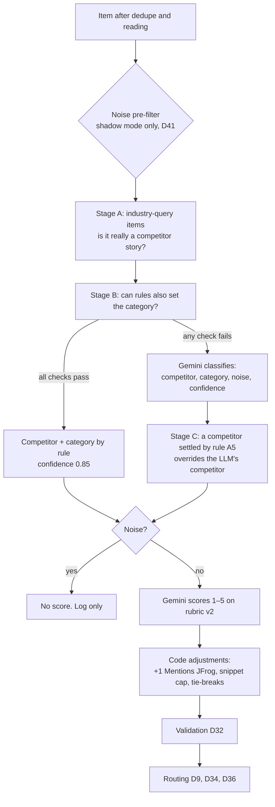

# Jessi rules: classify, category, ranking and routing (DRAFT, 2 Nov 2026)

What decides each item's competitor, category, noise flag, score and route (published or held). Text is taken from the PRD (decision IDs given)
and from the files the pipeline actually reads at `main` ae8fbb5. Where the code holds the exact wording, the code's
wording is quoted, because that is what runs. Differences between the PRD and the code are listed at the end and in
`GAPS_AND_QUESTIONS.md` (c20, c22–c24).

All of these rules are **frozen** since 31 Oct (D41, D57). The classify and rank prompts, rules and the rubric file
are hashed into the `classify_rank` fingerprint (99b79890ceea); changing any of them changes the fingerprint and
would void the test-split eval (D23, D66).

## 1. Order of decisions for one item

Rules only ever **settle** a competitor or category when they are certain. No rule discards an item: "the default is
'run the LLM'; rules only skip it when they are certain" (D25).

---

## 2. Classify rules: which competitor

**Scope (D10).** Cloudsmith, Sonatype, GitHub, GitLab, Snyk, AWS, plus an **Industry** channel (supply-chain attacks,
AI-agent and MCP security). The list lives in `config/competitors.yaml`. An item about none of them, and not such
industry news, gets competitor "none".

### Stage A: items found by an industry query (PRD, Competitor tagging rules)

| # | Check | Outcome | Example title |
| --- | --- | --- | --- |
| A1 | Not prefilled industry | Skip to Stage B | "Cloudsmith adds npm provenance checks" (Cloudsmith query) |
| A2 | Market chatter, marketing or roundup title | Stays industry, LLM decides | "GitLab stock rallies after earnings" |
| A3 | No tracked competitor in the title | LLM, as industry | "Malicious npm packages steal developer tokens" |
| A4 | Two or more competitors in the title | LLM, as industry | "GitHub and GitLab patch the same Ruby flaw" |
| A5 | Exactly one, and it is the subject: name + strong verb (not followed by ":"), or possessive + product word | Competitor settled by rule; category and noise still decided later | "GitHub Launches npm Firewall…", "GitHub's npm firewall can block…" |
| A6 | Exactly one, but not the subject: a venue, a weak verb, "verb:" or a mid-title mention | LLM with hint "company or platform?"; industry is the fallback | "Hackers Hide Malware in 42 GitHub Repositories", "GitHub's repositories abused…" |

### Stage B: items with a competitor; can rules also set the category?

| # | Check | Outcome | Example title |
| --- | --- | --- | --- |
| B1 | Competitor is industry or none | LLM | any remaining industry item |
| B2 | Chatter, marketing or roundup title | LLM | "Snyk UNFILTERED summit recap" |
| B3 | A rival dominates the mentions (a title mention counts ×3) | LLM | a Sonatype-query item mostly about Snyk |
| B4 | Title also names another competitor | LLM | "Sonatype and Snyk both flag new PyPI malware" |
| B5 | Competitor not in the title, and the source is not its own feed, listing or repo | LLM | "New Maven Central trust controls" |
| B6 | No category keyword, or several (exception: its own GitHub release is Product & Features) | LLM | "GitHub Copilot Fusion: route and orchestrate models" |
| B7 | Everything passes | Competitor + category by rule, confidence 0.85 | "Cloudsmith: Deprecating Trivy vulnerability scanning" (own changelog) |

### Stage C: after the LLM

A competitor settled in A5 overrides the LLM's competitor.

### The word lists behind A5 (from `ci/classify.py`)

- **Strong verbs (subject case):** launch, add, introduce, unveil, announce, release, acquire, preview, debut, expand,
  update, ship, roll out, patch, fix, in their common forms. None counts when directly followed by ":" ("GitHub
  updates: attackers…" is not settled). Weak verbs (make, bring) were removed. Verbs for funding, pricing and
  leadership (raises, partners, cuts, appoints) are left out on purpose, so those titles go to the LLM.
- **Product words (possessive case):** Copilot, Dependabot, CodeQL, Advanced Security, Actions, Duo, Orbit, Nexus,
  CodeArtifact, Amazon ECR, Amazon Inspector, "npm firewall", "npm package firewall", "package firewall". This is an
  allow-list, not a list of venues: after "GitHub's", anything that is not a listed product goes to the LLM with the
  hint. Generic words (npm, registry, AI, agent, scanner, MCP, CLI, Packages, bare "firewall") were removed because
  they let a venue settle by rule again; "GitHub's npm registry hit by worm", "GitHub's AI agents leak tokens" and
  "GitHub's MCP server exposed" are pinned as hint cases.
- **Title lead:** a short lead such as "Exclusive:" or "The" before the competitor's name is allowed.

### What the LLM is told about the competitor (classifier prompt, `ci/classify.py`)

- The prefilled competitor is only the search query that found the item and may be wrong.
- Use "industry" for news that matters to JFrog without centering on one tracked competitor (software supply-chain
  attacks, malicious packages, AI-agent and MCP security); use "none" for anything else.
- With the hint "Competitor named in title: <key> — company or platform?", use the key only when the story is about
  the company or its product; when the title names it as the place something happened (malware in GitHub
  repositories), keep "industry".
- `full_text_mentions` gives how often each competitor is named across the whole page, so a listicle that names a
  competitor deep in the text can still be read correctly.
- The model sees the title and the first 1,500 characters of text, inside `<item_text>` tags marked as data (D32, D51).

### Regression tests (D24)

Every title a review or the golden set showed the rules got wrong is pinned as a test with its expected outcome, so a
fix for one title cannot silently re-break another.

---

## 3. Category rules

### The seven categories (D11) and their definitions

One primary category per item. The definitions below are the ones the classifier prompt uses, word for word
(`CATEGORY_DEFINITIONS` in `ci/classify.py`).

| Category | Definition given to the model |
| --- | --- |
| Product & Features | it improves product capabilities, infrastructure, compatibility, performance or interfaces, without security as its central value |
| Pricing & Packaging | prices, plans, tiers, licensing, free-tier or bundling changes |
| AI & Agents | AI features, coding assistants, agents, MCP servers, LLM capabilities in the product |
| Security | the development's central value is detecting, preventing, analyzing or reducing security risk |
| Funding/M&A/Partnerships | funding rounds, acquisitions, mergers, IPOs, strategic partnerships |
| Customers & Market | customer wins, analyst reports, market share, surveys, adoption and market positioning |
| Leadership & Org | executive hires and departures, layoffs, reorganizations |

A cross-cutting **Mentions JFrog** flag sits on top of the category (D11). It is set when the page names jfrog,
artifactory, frogbot or swampup. Bare "Xray" is left out because it is also a proxy tool; URLs and domains do not
count as mentions. Known issue: the match runs over the whole fetched page, not only the stored text (D57).

### Tie-break rules between categories (D40, D41; given to the model word for word)

1. **Security vs Product & Features (D40):** Security when the development's central value is detecting, preventing,
   analyzing or reducing security risk; Product & Features when it improves product capabilities, infrastructure,
   compatibility, performance or interfaces without security as its central value.
2. **Pricing & Packaging (D41):** "a change in price, what's included, tiers, seats or licensing is Pricing &
   Packaging, even when the product is AI."
3. **AI & Agents vs Security (D41):** "a product or capability for AI agents, MCP or models is AI & Agents, even when
   its value is security. An attack on, or a vulnerability in, any tool, AI tools included, is Security."

Why rule 2 exists: "Copilot included in GitHub Enterprise" was classified AI & Agents, so a pricing change skipped
the review that D9 forces on Pricing (D41).

### When rules set the category without the LLM (Stage B6, `ci/classify.py`)

A title must match the keywords of **exactly one** category; zero or several matches go to the LLM. Keywords are kept
narrow on purpose.

| Category | Title keywords (summary) |
| --- | --- |
| Funding/M&A/Partnerships | acquire / acquisition, merger, funding, raises, Series A–F, invest…, partner…, IPO |
| Pricing & Packaging | pricing, price change, per seat, free tier / plan, licens…, subscription, new plan(s) |
| Leadership & Org | CEO, CTO, CFO, CISO, chief … officer, appoint…, steps down, layoff(s), hires, joins as, reorg… |
| Security | security, vulnerabilit…, CVE, exploit, malicious, malware, breach, attack(er)s, secret scanning, supply chain, patch(es/ed), CVSS, zero-day, backdoor, RCE, researcher(s), compromised |
| AI & Agents | AI agent(s), AI-powered, AI model(s), agent(s), agentic, Copilot, MCP, LLM(s), GenAI, Duo |
| Customers & Market | customer(s), Gartner, Forrester, IDC, market share, case study, adopts, selects, consolidates, migrates, moves to, switches to |
| Product & Features | launch…, release(s/d), generally available / GA, now supports, introduc…, new feature, public preview, beta, adds, announces, changelog, deprecat…, sunset…, a version number |

Three guards send a title to the LLM even when one category matches:
- **Packaging words** (includes, included, seats, tiers, bundle, add-on): a bundling title may be Pricing, which only
  the D41 rule can decide.
- **Security-product words** (firewall, scanning, SAST, DAST, SCA, secrets detection, code scanning, vulnerability
  management): a launch of a security product is Security or Product by its central value, which a keyword cannot
  tell (D40). "GitHub package firewall in public preview" was once ruled Product by keyword (D24).
- **Chatter and marketing words** (stock, shares, earnings, rally, summit, webinar, report, "top 10", "best", "vs",
  guide, how to, why…): possibly noise, so the LLM judges them.

---

## 4. Noise rules

**Definition (rubric v2, D29, D40).** Noise = not relevant to what we track, or no intelligence value. It is separate
from the score: a noise item gets no score at all.

**What the classifier is told (prompt text):** noise is true only for "stock-price or trading chatter, a different
company with a confusable name, review-site pages, generic SEO content, or news outside software supply chain,
DevSecOps and developer tooling. Marketing, opinion, listicles, comparisons and buyer's guides that reveal a vendor's
positioning or strategy are NOT noise (they score 2 on the rubric). Noise is independent of competitor: a GitHub story
can still be noise."

**Noise pre-filter (D25, D41; built, in shadow mode only).** It would mark an item as noise without an LLM call when
the title is stock chatter (price target, 52-week high or low, fund share trades, "is it a buy", stake or holdings
changes, analyst ratings, short interest, institutional investors) or the URL is a review site (g2.com, capterra.com,
softwareadvice.com). It never fires when the title or full text carries an event-protection word: vulnerability, CVE,
zero-day, breach, outage, acquisition / acquire, funding, raises, pricing, price change, partnership / partners, GA,
generally available, launch. Today it only records what it would have done; turning it on is in the Not-now list.

---

## 5. Ranking rules: rubric v2

The ranker reads `config/rubric_v2.md` word for word into its prompt, so labels, the coverage list and the ranker
score on the same text. Frozen since 30 Oct (D29). The text below is that file.

**Principle.** The score is the competitive impact on JFrog, not the size of the improvement or how dramatic the
headline is. The item's type sets the default; substantive content can raise it (a patch fixing an actively exploited
critical flaw is 3–4, not 1). Keywords never raise a score by themselves. Uncertainty does not raise a score: an
unverifiable gap is not a 4.

| Score | Competitor | Industry | Shown in |
| --- | --- | --- | --- |
| 5 | Strategic move at significant scale against a JFrog core product (Artifactory, Xray, Curation) or its positioning; a material acquisition | A market-changing event (rare) | Brief |
| 4 | Material competitive change backed by evidence: a capability-level gap opened or closed, or a business/security event with direct competitive impact | A major event in JFrog's market: a broad supply-chain attack on a package or AI-tooling ecosystem, new regulation | Brief |
| 3 | Relevant development without a proven material change: improves an existing capability, a sub-feature, a partnership, a customer win, a security event with indirect impact | A relevant vulnerability or incident of limited scope | Brief |
| 2 | No new event, but intelligence value: marketing, opinion, listicle, buyer's guide that reveals positioning or strategy | Commentary and research | Competitor profile |
| 1 | A routine operational event: patch release, version support, maintenance, deprecation of a minor feature, a default/config change | — | Competitor timeline |
| Noise | Not relevant, or no intelligence value: stock chatter, VC-firm "Nexus", review-site pages, generic SEO content | same | Log only |

**The 3-vs-4 line: capability or sub-feature (D28, rubric file).** A capability is something a buyer's comparison
checklist would list (secrets detection, reachability / Contextual Analysis, package firewall / Curation, MCP
registry). Management views, scan-frequency controls, performance, an extra integration or language are sub-features,
so 3, judged at capability level even when it is unknown whether JFrog has the exact sub-feature. Preview or beta
lowers a step, except for a move against a JFrog core capability. GA of an existing preview is 3 by default. The JFrog
capability sheet (`config/jfrog_capabilities.md`) lists the capabilities per axis.

**Rubric clarification (30 Oct, PRD).** "The score reflects competitive impact on JFrog, not the size of the
competitor's improvement. 3 = a competitor improves a capability it already had; 4 = it closes or opens a gap against
JFrog, or changes what buyers compare."

**The 2-vs-3 line (D40; ranker prompt).** 2 = content without an event (marketing, opinion, a listicle, a comparison
or buyer's guide, commentary or research): it can reveal positioning, but nothing happened. 3 = a relevant event:
something a competitor or the market actually did (a release, a feature, a partnership, a customer win, an incident).

**Vulnerabilities (D41; ranker prompt).** News reporting a new vulnerability is 3. A third party's explainer or
analysis of an already-published vulnerability is 2 (commentary on someone else's event).

**Importance vs freshness (D27).** The score labels how much the event changes JFrog's competitive picture, whatever
its age. An old but relevant event is never Noise; age decides placement ("Found late"), not the score.

### Anchor examples

| Item | Score | Why | Where stated |
| --- | --- | --- | --- |
| Amazon ECR replication backfill | 3 | Improves replication ECR already had; no new gap against Artifactory | PRD and rubric file |
| GitHub package firewall, public preview | 5 | Head-on against Curation at GitHub's distribution scale; preview does not lower a core-capability move | PRD and rubric file |
| "5 Best SCA Tools" vendor listicle | 2 | Marketing content, no event | PRD and rubric file |
| GitLab vs SonarQube review-site page | Noise | Evergreen comparison page, no event | PRD and rubric file |
| Cloudsmith Mumbai storage region | 3 | Real product event, extends market reach | Rubric file only |
| GitHub Enterprise includes Copilot | 3 | Indirect impact, not proven; the platform-bundling trend belongs in insights | Rubric file only |
| GitLab patch release 19.5.3 | 1 | Routine operational event | Rubric file only |

### What the ranker returns

For each item: a score 1–5 (noise items are never sent to it), a one-line reason under 25 words naming what drove
the score, and a one-line `why_it_matters`. The model sees the competitor, category, source, publisher, title and the
first 2,500 characters of text (the classifier sees 1,500). The UI shows the lens, not the ranker's `why_it_matters`, under "Why it matters to
JFrog"; the ranker's reason sits in the score badge tooltip (D45, D58).

### Code adjustments after the model (`ci/rank.py`)

Labels are base scores; these adjustments are not part of labels (rubric file).

| Step | Rule | Value |
| --- | --- | --- |
| 1. Mentions JFrog bonus | +1 when the item mentions JFrog, capped at 5 | +1 |
| 2. Snippet cap | An item with only a snippet (or junk extraction) cannot score above the cap (Ofri, 30 Oct: was 3) | 4 |
| 3. Review hold | A snippet-only or junk item scored at or above 4 goes to review: a high score resting on a teaser needs a human (D36) | ≥ 4 |
| 4. Order | Highest score first; ties by classifier confidence, then newest date. Unscored (failed) items next, noise last | — |
| Failure | When the model gives no usable score, the item gets none, is marked degraded and goes to review; a failure never looks like a normal score | — |

Known issue: the bonus raised a score Ofri judged too high in 2 cases (n = 2, D62), because the mention can come from
page text the model never saw (D57).

### Rubric limits found so far

- **Industry funding rounds** have no cell: the Industry column covers attacks, incidents and regulation, so a funding
  round of an adjacent AI-security startup has no fitting score (2 Nov, Pitfalls). No label proposed; the rubric stays
  frozen.
- **The lens relation** has the same kind of gap: 5 of 8 wrong relations had no fitting value (D58).

---

## 6. Routing rules: what is published and what waits for an analyst

Read from the code at ae8fbb5, not from the PRD, because the code is what runs. The main file is `ci/route.py`. The
API adds analyst decisions and trusted hosts (`ci/api/service.py`), and the Review screen shows the labels in
`frontend/src/lib/format.ts`. Line numbers refer to ae8fbb5, which was `main` until the 3 Nov merges. `main` is 823645d after them;
`ci/route.py` and `ci/rank.py` are unchanged there, while `ci/api/app.py`, `ci/api/service.py`,
`frontend/src/lib/format.ts` and `frontend/src/app/review/page.tsx` changed, so their line numbers may differ. Every line reference
in this section was re-checked against ae8fbb5 on 3 Nov. The PRD used for comparison is the live PRD
([JFrog CI Tool — PRD & Decision Log](https://claude.ai/artifact/8ESCvx56dgF6LVfoKSKoif), rev 208, newest decision
D77), not `docs/specs/PRD.md`, which is stale. Differences from D9, D34 and D36 are listed in §6.6, and no side is
taken there. §6.7 is the short text for the Review screen's info button.

### 6.1 How routing works

| Rule | Source | Plain English |
| --- | --- | --- |
| Three levels: Strict, Balanced, Relaxed. The default is Strict | `ci/route.py:29-30` | The autonomy setting has three steps, and a new install starts at Strict. |
| The level is stored as one setting and changed through `PUT /api/v1/settings/autonomy-level` | `ci/store.py:485-496`, `ci/api/app.py:445-457` | One setting covers the whole system. It is not set per analyst or per competitor. |
| Status is computed on every read and never stored, so a level change re-routes at once | `ci/route.py:17-18`, `ci/route.py:114-123` | When you change the level, the queue and the Brief change straight away. Nothing needs to be re-run. |
| An item is held when at least one of its hold reasons applies at the current level | `ci/route.py:108-111` | One reason is enough to send an item to an analyst. |
| Noise is `dropped`: it gets no hold reasons and never reaches the queue or the Brief | `ci/route.py:74-75`, `ci/route.py:117-118` | Items judged not relevant go only to the Log, never to the review queue. |
| An analyst decision overrides routing. Order: dismissed, then flagged, then approved | `ci/api/service.py:128-141` | Once an analyst decides on an item, the autonomy setting no longer moves it. |
| `approved` and `flagged` count as published, alongside `auto_published` | `ci/api/service.py:26` | An item an analyst approves or flags is shown as published. |
| Review queue order: items with a reason that holds at every level first, then highest score, then oldest | `ci/api/app.py:427-430` | Items that would wait for an analyst at any setting are listed first. |
| Changed head-to-head cells come from the changes store, not from items, and are held at every level | `ci/route.py:103-105`, `ci/api/competitors.py:249-271` | Every change to a comparison-table cell waits for an analyst. |

### 6.2 Per autonomy level (news items)

In the tables below, "score" means the final score, after the +1 Mentions JFrog bonus and the snippet cap
(`ci/rank.py:75-81`). Noise is left out because it is dropped at every level.

**At a glance: which reasons hold an item at each level** (Held = the item waits for an analyst; — = this reason does
not hold it at that level)

| Hold reason (internal value) | Strict | Balanced | Relaxed | Source |
| --- | --- | --- | --- | --- |
| `unvetted_source` | Held | Held only when score ≥ 4 | — | `ci/route.py:77-80` |
| `low_confidence` | Held | Held | — | `ci/route.py:81-83` |
| `teaser_high_score` | Held | Held | — | `ci/route.py:84-86` |
| `junk_extraction` | Held | Held | — | `ci/route.py:87-88` |
| `pricing` | Held | Held | Held | `ci/route.py:89-90` |
| `m_and_a` | Held | Held | Held | `ci/route.py:91-92` |
| `mentions_jfrog` | Held | Held | Held | `ci/route.py:93-94` |
| `model_failure` | Held | Held | Held | `ci/route.py:95-97` |
| `invalid_output` | Held | Held | Held | `ci/route.py:98-99` |
| `changed_cell` (comparison-table cells, not news items) | Held | Held | Held | `ci/route.py:103-105` |

These ten values are the only ones the code produces: `hold_reasons()` builds nine (`ci/route.py:72-100`) and
`change_hold_reasons()` builds `changed_cell` (`ci/route.py:103-105`). The levels come from `held_at` on each reason
(`ci/route.py:32-33`, `ci/route.py:108-111`).

**Strict** (default)

| Held for an analyst | Published automatically |
| --- | --- |
| Any item from an unvetted source, whatever its score (`unvetted_source`) | A non-noise item that meets all of these: |
| Classifier confidence below 0.8 (`low_confidence`) | • from a vetted or trusted source |
| Headline or teaser only (`snippet`) and score 4 or more (`teaser_high_score`) | • confidence 0.8 or higher |
| Page text judged junk and score 4 or more (`junk_extraction`) | • not a teaser-only or junk item scored 4 or more |
| Category Pricing & Packaging (`pricing`) | • category is not Pricing & Packaging or Funding/M&A/Partnerships |
| Category Funding/M&A/Partnerships (`m_and_a`) | • does not mention JFrog |
| Mentions JFrog (`mentions_jfrog`) | • classifier and ranker both answered |
| Classifier or ranker gave no usable answer (`model_failure`) | • passed output validation |
| Rejected by output validation, D32 (`invalid_output`) | |

**Balanced**

| Held for an analyst | Published automatically |
| --- | --- |
| Unvetted source **and score 4 or more** (`unvetted_source`). An item with no score is not held for this reason but is held as `model_failure` | Everything Strict publishes, plus unvetted-source items scored 1–3 that no other reason holds |
| Classifier confidence below 0.8 (`low_confidence`) | |
| Teaser-only and score 4 or more (`teaser_high_score`) | |
| Junk text and score 4 or more (`junk_extraction`) | |
| `pricing`, `m_and_a`, `mentions_jfrog`, `model_failure`, `invalid_output` (as at Strict) | |

**Relaxed**

| Held for an analyst | Published automatically |
| --- | --- |
| Only the reasons that hold at every level: `pricing`, `m_and_a`, `mentions_jfrog`, `model_failure`, `invalid_output` (and `changed_cell` for comparison-table cells) | Every other non-noise item, including unvetted sources at any score, low confidence, and teaser-only or junk items scored 4 or more |

### 6.3 Hold reasons that apply at every level

| Key | Exact condition in the code | Label the UI shows | Source | Plain English |
| --- | --- | --- | --- | --- |
| `pricing` | `x.category == "Pricing & Packaging"` | Pricing | `ci/route.py:34`, `ci/route.py:89-90`; label `frontend/src/lib/format.ts:55` | Pricing and packaging news always goes to an analyst, whatever the autonomy setting. |
| `m_and_a` | `x.category == "Funding/M&A/Partnerships"`, which covers the whole category, so funding rounds and partnerships are included | M&A / funding | `ci/route.py:34`, `ci/route.py:91-92`; label `format.ts:56` | Funding, acquisition and partnership news always goes to an analyst, whatever the autonomy setting. |
| `mentions_jfrog` | `x.mentions_jfrog` is true (see §6.5 for how it is set) | Mentions JFrog | `ci/route.py:93-94`; label `format.ts:57` | Items that mention JFrog always go to an analyst, whatever the autonomy setting. |
| `model_failure` | `x.classifier_degraded or x.ranker_degraded`: the classifier fell back (`ci/classify.py:470-473`) or the ranker gave no usable score (`ci/rank.py:220-222`) | Model failure | `ci/route.py:95-97`; label `format.ts:58` | When the model gave no usable answer, the item always goes to an analyst instead of being shown with a made-up value. |
| `invalid_output` | The item has at least one D32 validation rejection in the store (`store.rejection_reasons()`) | Invalid model output | `ci/route.py:98-99`, `ci/store.py:329`, `ci/validate.py:138-150`; label `format.ts:59` | When the model's answer broke the output rules (score out of range, an unknown competitor or category, an unknown item ID), the item always goes to an analyst. |
| `changed_cell` | Every changed head-to-head cell with status `awaiting_review` in the changes store | Changed head-to-head cell | `ci/route.py:103-105`, `ci/api/competitors.py:249-271`; label `format.ts:60` | Every change to a cell of the comparison table always goes to an analyst. |

A key with no entry in the UI label map is shown with its underscores replaced by spaces
(`frontend/src/lib/format.ts:97-98`). Every key above has an entry.

### 6.4 Hold reasons that depend on the level

| Key | Held at | Exact condition in the code | Label the UI shows | Source | Plain English |
| --- | --- | --- | --- | --- | --- |
| `unvetted_source` | Strict; Balanced only when score ≥ 4 | `not vetted(x.url)`; Balanced is added when `x.score is not None and x.score >= 4` | Unvetted source | `ci/route.py:77-80`; label `format.ts:51` | At Strict every item from an unvetted publisher waits for an analyst, at Balanced only those scored 4 or 5, and at Relaxed none do. |
| `low_confidence` | Strict, Balanced | `x.confidence < 0.8` | Low confidence | `ci/route.py:31`, `ci/route.py:81-83`; label `format.ts:52` | At Strict and Balanced, items the classifier was unsure about wait for an analyst. |
| `teaser_high_score` | Strict, Balanced | `x.score >= 4` and `text_status == "snippet"` | High score on a teaser | `ci/route.py:84-86`, threshold `ci/rank.py:26`; label `format.ts:53` | At Strict and Balanced, an item scored 4 or 5 from its headline or teaser alone waits for an analyst. |
| `junk_extraction` | Strict, Balanced | `x.score >= 4` and `text_status == "junk"` | Junk extraction | `ci/route.py:87-88`, threshold `ci/rank.py:26`; label `format.ts:54` | At Strict and Balanced, an item scored 4 or 5 whose page text could not be read cleanly waits for an analyst. |

What "vetted" means in the code:

| Rule | Source | Plain English |
| --- | --- | --- |
| A host is vetted when it, or a parent domain, is listed under `first_party` or `trade_press` | `ci/sources.py:84-98`, `config/vetted_sources.yaml` | A source counts as vetted when its site is on the approved list of competitor sites and trade press. |
| github.com and gitlab.com are vetted only under the tracked orgs, and only for releases, tags, blob/tree and changelog pages | `ci/sources.py:27`, `ci/sources.py:76-81`, `config/vetted_sources.yaml` `github_orgs` / `gitlab_orgs` | On GitHub and GitLab only a competitor's own release, file and changelog pages count as vetted. Issues, discussions and pull requests do not. |
| gist.github.com is never vetted | `ci/sources.py:26` | Gists are never vetted, because anyone can post one. |
| A host trusted through "Trust this source" counts as vetted, and so does any subdomain of it | `ci/api/service.py:115-120`, `ci/store.py:443` | Once an analyst trusts a source, its items are routed as vetted. |
| github.com, gitlab.com, gist.github.com and hosts already on the list cannot be trusted | `ci/api/app.py:602-608` | Trust cannot be used to bypass the per-org GitHub and GitLab rule. |
| Trust is suggested after 3 or more approvals and 0 dismissals from one host | `ci/api/service.py:31`, `ci/api/service.py:264-269` | After an analyst approves 3 items from a source and dismisses none, the queue suggests trusting it. |

### 6.5 Mentions JFrog: the hold and the +1 bonus

One flag drives two separate rules.

- **The flag** (`ci/classify.py:253-256`). True when the regex `\b(jfrog|artifactory|frogbot|swampup)\b`
  (`ci/classify.py:58`, case-insensitive) matches the title plus the stored text with URLs removed. It is also true
  when the full-page mention count, taken before text truncation, found JFrog. The LLM does not set it ("Mentions
  JFrog is always the regex", `ci/classify.py:8`). A bare "Xray" does not count (`ci/classify.py:53-54`).
- **The hold** (`ci/route.py:93-94`). It holds the item at every level and does not read the score.
- **The bonus** (`ci/rank.py:24`, `ci/rank.py:75-77`). It adds +1 to the score when the score is below 5 and records
  "+1 Mentions JFrog" in the adjustments. The snippet cap runs after it (`ci/rank.py:79-81`), so a teaser-only or junk
  item that mentions JFrog still ends at 4 at most.

How they relate:

1. Both rules read the same flag, and neither rule reads the other.
2. Every item with the flag is already held at every level, so the bonus never decides whether routing publishes an
   item. It changes the score the analyst sees, the item's place in the queue and, after approval, its place in the
   Brief.
3. The bonus can add more hold reasons to an item the flag already holds. A teaser-only item with model score 3
   becomes 4 and is also listed as `teaser_high_score`. An unvetted item with model score 3 becomes 4 and is also held
   as `unvetted_source` at Balanced. The status stays the same; only the list of reasons gets longer.

Plain English: "Items that mention JFrog always go to an analyst, whatever the autonomy setting, and their score is
raised by one point (never above 5) so they rank higher once approved."

The flag can come from page text the ranker never saw, and the bonus raised a score Ofri judged too high in 2 cases
(n = 2, D62; EXPERIMENTAL; see §5).

### 6.6 Differences from the PRD

Quotes are from the live PRD (rev 208, read 3 Nov; newest decision D77): the D9, D34 and D36 rows of the Decision log
and the "Routing (D9)" paragraph under Item lifecycle. In those rows the live text matches what the stale
`docs/specs/PRD.md` said. No later decision (D37–D77) changes the level rules. Neither the code nor the PRD is judged
right here.

What matches D36 word for word: low confidence below 0.8 held at Strict and Balanced (`ci/route.py:31`,
`ci/route.py:81-83`); model failures and D32 rejections held at every level (`ci/route.py:95-99`); teaser-only and
junk items held at Strict and Balanced and published at Relaxed (`ci/route.py:84-88`); the trust suggestion after 3+
approvals with 0 dismissals (`ci/api/service.py:31`, `ci/api/service.py:264-269`).

1. **Threshold vs levels.** D9: "Confidence-based routing: each item is auto-published or sent to an analyst review
   queue by one autonomy threshold". Code: three named levels defined by hold reasons, with no threshold number
   (`ci/route.py:3`, `ci/route.py:29`). D34 says it "updates D9", but the D9 row has not been changed.
2. **"M&A" vs the whole category.** D9: "high-stakes categories (pricing, M&A, security claims about JFrog)". Code:
   `m_and_a` holds the whole "Funding/M&A/Partnerships" category, funding rounds and partnerships included
   (`ci/route.py:34`, `ci/route.py:91-92`; the docstring at `ci/route.py:11` says "(the whole category)"). The UI label
   is "M&A / funding" and does not mention partnerships (`frontend/src/lib/format.ts:56`).
3. **"Security claims about JFrog".** D9 lists it as a forced-review category. The code has no rule for the Security
   category combined with JFrog. The closest rule is `mentions_jfrog` (`ci/route.py:93-94`), which holds any item that
   names JFrog through the regex, in any category, and does not match an item that names only a bare "Xray"
   (`ci/classify.py:53-58`).
4. **"Forced" low confidence.** D9: "Review is forced for low classifier confidence". Code: held at Strict and
   Balanced only, so published at Relaxed (`ci/route.py:81-83`). This matches D36: "Low confidence (below 0.8) is
   held at Strict and Balanced".
5. **"Forced" for unvetted sources.** D9: "Review is forced for … unvetted sources". Code: held at Strict, at Balanced
   only when score ≥ 4, and not at Relaxed (`ci/route.py:77-80`). This matches D34's level definitions.
6. **Relaxed holds more than D34 lists.** D34: "Relaxed = only the always-held reasons (Pricing, M&A, Mentions JFrog,
   changed head-to-head cells)". Code: Relaxed also holds `model_failure` and `invalid_output` (`ci/route.py:95-99`).
   Both come from D36 ("model failures and D32 rejections are held at every level") and the PRD's Routing (D9)
   paragraph ("Held at every level: Pricing and M&A items, Mentions JFrog, every changed head-to-head cell, and model
   failures or validation rejections (D32, D36)").
7. **Balanced holds more than D34 lists.** D34: "Balanced = unvetted held only at score ≥4". Code: Balanced also holds
   `low_confidence`, `teaser_high_score` and `junk_extraction` (`ci/route.py:81-88`), from D36.
8. **Strict holds more than D34 lists.** D34: "Strict = every unvetted source + everything D9 always holds". Code:
   Strict also holds `teaser_high_score` and `junk_extraction` (`ci/route.py:84-88`, D36). Neither appears in D9.
9. **Which score the ≥ 4 checks use.** D34 says "score ≥4" without saying whether this is the model's score or the
   final one. D36 says "Teaser-only high scores" and gives no number. The code uses 4 for both
   (`SNIPPET_REVIEW_MIN = 4`, `ci/rank.py:26`; `ci/route.py:78`). Code: `x.score` is the final score, after the +1 bonus and the snippet cap (`ci/route.py:65-67`,
   `ci/rank.py:75-81`).
10. **Where "Trust this source" writes.** D34: "a "Trust this source" action in the review queue that adds a
    publisher to the vetted list". Code: trusted hosts are stored in the store (`ci/store.py:443`) and combined with
    `config/vetted_sources.yaml` when the API reads them (`ci/api/service.py:115-120`). The yaml file is not changed.
    `python -m ci.route` counts with the yaml list only (`ci/route.py:72`, `ci/route.py:152-156`), so its counts do
    not include trusted hosts.
11. **D34's counts were not re-measured here.** D34: "Strict 84, Balanced 28 held of 228". This was measured on 31 Oct.
    Vetting changed after that (github.com per org, D49; gitlab.com, D53; advisories, D56). Whether the counts are the
    same at ae8fbb5 is unknown, and this draft did not open the store to check.

Notes on the code itself, for the record. These are not differences from the PRD.

- `ci/rank.py:86-91` defines the teaser and junk review rules a second time and stores them as `needs_review` /
  `review_reasons` on the ranking (`ci/store.py:78`). Routing does not read those fields. It recomputes the rules in
  `ci/route.py:84-88`. Both use `SNIPPET_REVIEW_MIN = 4` (`ci/rank.py:26`).
- `ci/insights.py:132-140` (`published()`) calls `route.status` without trusted hosts. It is not called from `ci/` at
  ae8fbb5. The daily run selects insight inputs through the API's status, which does include trusted hosts
  (`ci/daily.py:376`).
- Two constants share the name `LOW_CONFIDENCE`. In `ci/route.py:31` it is the 0.8 hold line. In `ci/classify.py:48`
  it is the 0.2 confidence given to a failed answer, and such an item is also held as `model_failure`.

### 6.7 Short version for the UI (info button next to "What needs my decision?")

Ready to paste. The panel title is "What needs my decision?" (`frontend/src/app/review/page.tsx:93`). The labels are
the ones the UI already shows (`frontend/src/lib/format.ts:50-61`). The first line follows the queue query
(`ci/api/app.py:418-433`): items whose status is `awaiting_review` at the current level, plus changed cells awaiting
review; analyst-decided items and noise are not in it.

> This queue lists the items held for an analyst at the current autonomy level, plus every changed head-to-head
> cell. Items held at every level come first.
>
> - **Unvetted source:** the publisher is not on the vetted list. Held at Strict, and at Balanced only when scored 4 or 5.
> - **Low confidence:** the classifier's confidence was below 0.8. Held at Strict and Balanced.
> - **High score on a teaser:** scored 4 or 5 from only a headline or teaser. Held at Strict and Balanced.
> - **Junk extraction:** scored 4 or 5, but the page text could not be read cleanly. Held at Strict and Balanced.
> - **Pricing:** pricing or packaging news. Always held.
> - **M&A / funding:** news about funding, an acquisition or a partnership. Always held.
> - **Mentions JFrog:** the item names JFrog or one of its products. Always held.
> - **Model failure:** the AI model gave no usable answer for this item. Always held.
> - **Invalid model output:** the AI model's answer broke the output rules. Always held.
> - **Changed head-to-head cell:** a value in the comparison table changed. Always held.

---

## 7. Where each rule lives

| Rule | File | Frozen by |
| --- | --- | --- |
| Competitors and aliases | `config/competitors.yaml` | D10 |
| Stages A–C, verbs, product words, category keywords, category definitions and D40/D41 rules, classifier prompt | `ci/classify.py` | D41, D57 (classify_rank 99b79890ceea) |
| Rubric v2 text read into the ranker | `config/rubric_v2.md` | D29 |
| 2-vs-3 line, vulnerability rule, bonus, snippet cap, ordering | `ci/rank.py` | D40, D41 |
| Noise pre-filter (shadow) | `ci/prefilter.py` | D25, D41 |
| Capability sheet (3-vs-4 reference, lens, insights) | `config/jfrog_capabilities.md` | sheet_sha e7f13e0b3456 |
| Hold reasons, levels, status | `ci/route.py` | D9, D34, D36 |
| Vetted hosts, per-org GitHub/GitLab rule | `config/vetted_sources.yaml`, `ci/sources.py` | D34, D49, D53 |
| Trusted hosts, analyst decisions, trust suggestion | `ci/api/service.py`, `ci/store.py` | D16, D34, D36 |
| UI labels of hold reasons | `frontend/src/lib/format.ts` | — |
| Regression tests for misfires and injections | `tests/ci/` | D24, D51 |

## 8. Differences between the PRD and the code

Not resolved here; see `GAPS_AND_QUESTIONS.md` c20 and c22–c24. Routing differences are in §6.6 and c25.

1. The rubric file the ranker reads has lines the PRD's rubric table lacks: "Keywords never raise a score by
   themselves", "an unverifiable gap is not a 4", "GA of an existing preview = 3 by default", extra examples in the
   1 and 2 rows, and three extra anchors (Cloudsmith Mumbai, GitHub Enterprise includes Copilot, GitLab 19.5.3).
2. D29 says "the classifier also outputs an event type" and "the ranker outputs gap\_verified and a confidence". In
   the code, `event_type` exists only in the coverage check (`ci/coverage.py`), and `gap_verified` appears nowhere in
   `ci/`.
3. The PRD gives no value for the snippet cap ("caps snippet-only items"); the code uses 4.
4. The tagging rules section says "As of main a7a758e (30 Oct)". The verb list and product words match the code at
   ae8fbb5; the rest of Stage A and B was not re-checked line by line.
