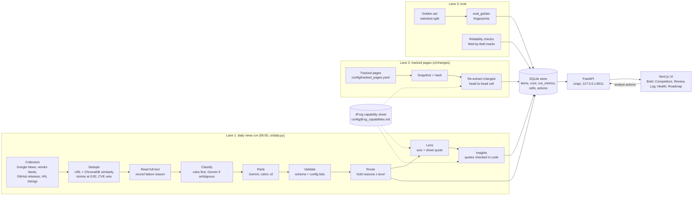
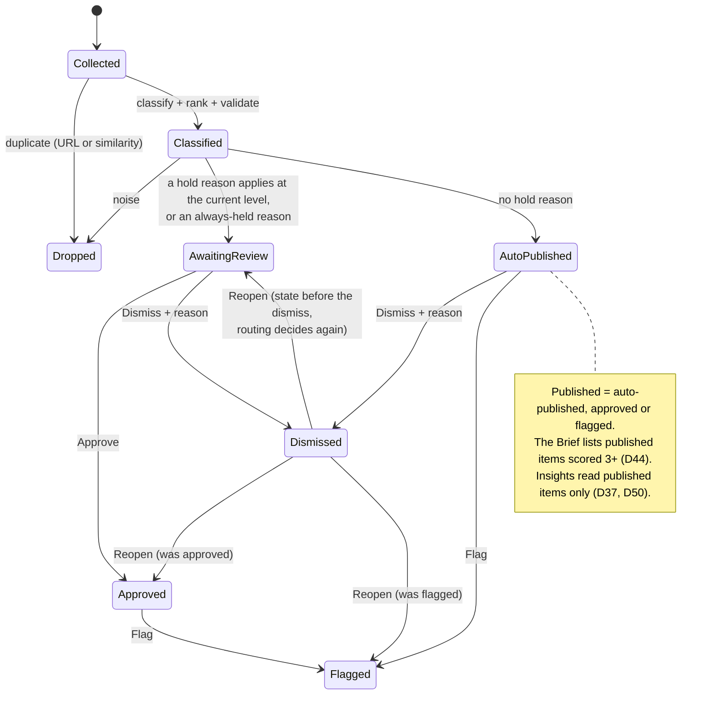

# Jessi: Stage 1 overview (DRAFT)

> **Draft for Ofri's review, 2 Nov 2026.** Source of truth: `docs/specs/PRD.md` (decision log up to D66) and the repo
> at `main` ae8fbb5. Every number has its n, a decision ID and a status:
> **PROVEN** (measured on data the tuning never saw), **EXPERIMENTAL** (measured, but small n, single labeler, or the
> tuning data), **PENDING** (planned, not run yet), **FUTURE** (not built). All labels are by one labeler (Ofri).
> Every sentence that rests on a result not in yet carries a `[PENDING: …]` tag, so one search finds them all.
> Full list of numbers: `EVIDENCE_TABLE.md`. Open points: `GAPS_AND_QUESTIONS.md`.

---

## a. The problem and what we built

**The user.** A competitive-intelligence (CI) analyst at JFrog who starts the day asking: *what changed, and does it
matter for JFrog?* Today that work is manual, so signals are missed or arrive late (PRD, Problem & context). Readers
beyond the analysts (product, sales, executives) are future scope (D19).

**JFrog terms used below** (from the capability sheet, `config/jfrog_capabilities.md`):
- **Artifactory**: JFrog's universal repository manager; it stores packages and container images of many types.
- **Xray**: JFrog's scanner for open-source vulnerabilities and licences (SCA) in those packages and images.
- **Curation**: JFrog's "package firewall"; it blocks malicious, vulnerable or licence-violating packages before they
  enter.
- **Contextual Analysis**: part of JFrog Advanced Security; it checks whether a CVE is actually applicable in the code.

**Two primary needs, one screen each** (D21, D20):

| Screen | Need in the brief | What it answers |
| --- | --- | --- |
| **Daily Brief** | "keeps them updated daily on the latest news and insights" | What happened since the previous Brief? Published items scored 3+, what is held for review, and cross-item insights (marked experimental, D61) |
| **Competitors** | "see how JFrog compares to its main competitors" | Where does each competitor stand against JFrog? One card per competitor, then a profile with a head-to-head table against JFrog's capability sheet, each cell with a source and as-of date |

**Three supporting screens** keep the output correct and measurable (D21):

| Screen | What it answers |
| --- | --- |
| **Review queue** | Is this held item right, and does it belong? Approve, Dismiss with a reason, Edit, Flag, Reopen (D16, D62). The autonomy level is a control here (D34) |
| **Log** | What was collected, and where did each item stop and why? Every item, including dropped ones (D21) |
| **Health** | Does the system run, and is it correct? Run history, funnel, extraction per source, eval numbers with n (D48) |

A sixth tab, **Roadmap**, shows design-prototype concepts that have no pipeline data, each marked "Concept, sample
data" (D35).

**Scope.** Six competitors (Cloudsmith, Sonatype, GitHub, GitLab, Snyk, AWS) plus an Industry channel (supply-chain
attacks, AI-agent and MCP security), from a config file (D10).

**The answer to the brief in one sentence.** Jessi is a running daily pipeline with a web UI that collects public
competitor and industry news, tags and scores each item for its impact on JFrog, holds anything risky for an
analyst, maps each item to the closest JFrog capability, and reports every quality number with its n, including the
ones that failed.

---

## b. How it works

The daily run starts at 06:00 Israel time (D21) and covers everything discovered since the previous Brief (D31). Each
step below names the decision that defines it.

1. **Collect.** Collectors pull from Google News queries, vendor blogs and changelogs, GitHub releases, Hacker News and
   listing pages (`ci/collectors/`; scope table). No paid sources, nothing behind a login (non-goals).
2. **Dedupe and group into stories.** Exact URL first, then embedding similarity in ChromaDB (D6). Items about the
   same event form a **story** at a 0.82 similarity rule (D33), with a CVE-ID veto: two items that name different CVEs
   never merge (D38).
3. **Read.** The full article text is fetched and checked; when extraction fails, the reason is recorded
   (`cloudflare_challenge`, `http_403`, `timeout`, `empty`) and the item keeps only its feed teaser (D39).
4. **Classify: rules first, LLM for the ambiguous** (D24, D25). Rules settle only safe cases: the competitor is the
   subject of the title, or a possessive followed by a listed product word. Everything else goes to Gemini with a hint
   when one helps. Output: competitor, one of 7 categories (D11), a noise flag and a Mentions JFrog flag.
5. **Rank on rubric v2** (D29, frozen). Score 1–5 or Noise, by competitive impact on JFrog: 5 a strategic move at
   scale against Artifactory, Xray or Curation; 4 a material change backed by evidence; 3 a relevant development;
   2 content with intelligence value but no event; 1 a routine operational event. Code adds a Mentions JFrog bonus
   and caps teaser-only items.
6. **Validate.** Every model answer must match a schema: score in range, competitor and category from the config
   lists, item IDs that exist. Anything else is rejected, logged and routed to review (D32).
7. **JFrog lens** (D42, display per D58). A separate step after ranking; it never changes a score. For each non-noise
   item it names one of 7 axes and quotes, word for word, the closest capability line from the capability sheet; the
   quote is checked in code. The UI shows the axis and the capability line under "Closest JFrog capability". The
   relation (closes a gap, opens a gap, improves something both have) is stored but not shown, because the check
   measured it as wrong (section e).
8. **Route** (D9, D34, D36). One autonomy control with three levels:

   | Level | Held for review |
   | --- | --- |
   | **Strict** (default) | Every unvetted source; low classifier confidence (below 0.8); teaser-only high scores and junk extractions; plus the always-held reasons |
   | **Balanced** | Unvetted sources only at score 4+; low confidence; teaser-only high scores and junk; plus the always-held reasons |
   | **Relaxed** | Only the always-held reasons |
   | **Always held** | Pricing & Packaging and Funding/M&A items, Mentions JFrog, every changed head-to-head cell, model failures and validation rejections |

9. **Publish or hold.** Every item ends with a status and a reason: dropped (with the stage), auto-published, awaiting
   review, approved, dismissed or flagged (PRD, Item lifecycle). The Brief shows published items scored 3+ only (D44).
10. **Insights** (D37, D43, D50, D61). A generator reads the published items of a 7-day window (14 days when there are
    fewer than 15 stories) plus anything found since the previous Brief. An insight must cite at least 2 different
    stories; every claim carries a quote from its cited item, checked against the stored text, and any claim about
    JFrog must quote the capability sheet. A failed check rejects the insight. The Brief labels the section
    "Experimental: cross-item patterns" with its measured line (D61).
11. **Change detection** (D13, D20). Tracked pricing and product pages are read daily and hashed. On a change, the
    head-to-head cell is re-extracted, the new value goes to review (always held), and the difference is published as
    an item. No real changed cell has occurred yet (section e).
12. **Analyst actions** (D16, D62). Approve, Dismiss with a reason, Edit (per field), Flag, Reopen. Actions are
    append-only; each records the state before it. An Edit becomes a candidate golden-set label that Ofri merges by
    hand (D31).
13. **Eval.** A golden set with a train/test split locked per story (D23), reliability checks of daily runs marked
    field by field (D52), an expected-insights file (D43), a coverage check against known events (D26), and
    fingerprints of prompts, rules and config on every run (D53, D59).

### Architecture (current, as built)

Redrawn from the PRD's text ("3 lanes into one store"); the embedded diagram itself is not readable here.

### Item lifecycle

Edit changes category, competitor or score (noise is not editable) and writes one candidate label per changed field
(D62).
Reopen from an auto-published or awaiting-review state clears the decision so routing decides again
(`docs/api-contract.md` §13.1).

---

## c. Why these design choices

**Rules first, the LLM for anything ambiguous (D24, D25).** The default is to call the LLM; a rule only skips it when
it is certain. Rules settle which competitor an item is about (the competitor as the subject of the title, or a listed
product word), never whether to discard it, so a missed pattern costs one LLM call, not a lost event. GitHub "as a
company" versus GitHub "as a place where malware is hosted" took three review rounds, so every rule misfire is pinned
as a regression test (D24). A noise pre-filter exists but runs only in shadow mode (D41, Closing plan "Not now").

**Routing and earned autonomy (D9, D34).** Reviewing every item wastes analyst time; publishing everything risks wrong
claims. Autonomy is a control, not a constant: start Strict, relax as measured precision rises. A confidence slider
was rejected because classifier confidence takes only four values and rule-settled items sit at a fixed 0.85, so a
slider mostly toggled rule items (D34). Levels defined by hold reasons can be explained and counted: on the 14-day
import (n = 228 non-noise items), Strict held 84 and Balanced 28 (D34; EXPERIMENTAL). The default level is left as a
question for the hiring manager (Open questions).

**Train/test protocol and fingerprints (D23, D53, D59).** Prompts and rules were tuned on the train split only; the
reported classification numbers come from one run on the test split. Each run records fingerprints of the prompts,
rules and config, so a reader can check that the test run used the frozen system (classify_rank 99b79890ceea,
portable e04716a2a1d6, lens 1692c04ba7df, insights e99d23e4edcf; D66). The original fingerprint hashed absolute
paths, so a fresh clone got a different value; a portable fingerprint was added beside it rather than replacing it
(D59). Pass lines for reliability checks are fixed before any mark is made (D52, D55, D66). [PENDING: test-split eval]

**Prompt-injection defense (D32, D51).** Every article comes from a site JFrog does not control, and JFrog sells
AI-agent security, so this is the first question a reviewer would ask. The defense is layered and the README says the
problem is not solved: article text in delimited blocks marked as data; tags inside the article defanged in any letter
case; schema validation of every answer; every quote checked in code; human review as the backstop; a pinned set of
synthetic poisoned articles as regression tests. The LLM has no tools, so the worst case is wrong output, not an
action (D32). Still open: a planted sentence passes the quote check, because the check proves the words are in the
article, not that they are true (D51).

**The JFrog lens (D42, D58).** The brief's second need is how JFrog compares, and the first UI did not say how an item
relates to JFrog. The lens adds that meaning without touching anything measured: scores do not change, and every JFrog
claim must quote the capability sheet. The check of 1 Nov showed the split: the axis and capability quote are mostly
right, the relation was wrong every time it was claimed (section e). So the UI shows "Closest JFrog capability" and
hides the relation (D58). The cause is mainly the taxonomy: most wrong relations had no fitting value (external
events such as attacks, or an existing capability with no change). The redesign is future work.

**Insights shown, but marked experimental (D60, D61).** Insights are what turns a news feed into intelligence, so they
lead the Brief (D15). The 1 Nov check found the evidence layer holds (claims and citations) and the synthesis
overstates (titles, summaries). Leading with the least reliable component is acceptable only because the section is
titled "Experimental: cross-item patterns" and shows its measured line (D61). No generator change before submission.

**Append-only analyst actions (D62).** The first real analyst session (1 Nov) produced a Dismiss made by mistake that
could not be undone, and one note for several corrections. Now every action records the state before it; Reopen
returns an item to its exact earlier state and the Dismiss stays in the history; an Edit writes one candidate label per
changed field. Every analyst decision stays auditable.

**Observability (D48).** A run that never started or was killed looked like yesterday's success. Now: one
`run_metrics` row per run (ok, degraded, failed), stale and overdue detection on Health (a running row older than about
1 h; latest run older than about 26 h), a failed row for failures before the store opens, and the API log on disk.
LangSmith tracing of the daily run was deferred (D57); tracing is forced off in every eval run (D51).

---

## d. Built now vs future

"Partly built" means some of it runs today and the table says which part does not.

| Area | Demonstrated today | Partly built (what is missing) | Designed, not built (future) |
| --- | --- | --- | --- |
| Collection | 6 competitors + Industry from config (D10); Google News, vendor feeds, GitHub releases, HN, listing pages | Three trade-press sites are never readable (Cloudflare challenge); kept vetted, teaser only (D39) | Paid feeds, earnings calls, G2, patents, analyst-forwarding inbox (D7); auto-discovery of new entrants |
| Dedupe and stories | URL + embedding dedupe, 0.82 story rule, CVE veto (D33, D38) | Two events never merge (the firewall shows as two cards, D33) | Event merging when an item matches both; event model scored on its member with the most text (D39) |
| Classification | Rules first, Gemini for the ambiguous; 7 categories + Mentions JFrog (D11, D25) | Noise pre-filter in shadow mode only (D41) | Learned classifier from analyst feedback |
| Ranking | Rubric v2, frozen (D29) | Mentions JFrog regex reads past the stored text (known issue, D57) | Weights tuned on flags and dismissals |
| Lens | Axis + capability quote shown (D42, D58) | Relation stored, hidden in the UI (D58) | Lens redesign: competitor or external event, capability match, evidence, "relevant, impact undetermined" (D58) |
| Routing and review | Three levels, always-held reasons, Approve / Dismiss / Edit / Flag / Reopen, Trust this source (D9, D34, D62) | — | Per-analyst queues, SLAs |
| Daily Brief | Daily at 06:00, kept by date, published items 3+, held counts (D21, D44) | Insights marked experimental (D61); insight continuity (new / continuing / strengthened, D63) is on a branch not merged into ae8fbb5 | Insights with a lifecycle (D63); email and Slack delivery |
| Competitors | Cards and profile with head-to-head vs JFrog, source and as-of date per cell (D20) | "This week" AI summary: the API returns `not_built` (`ci/api/competitors.py`); 0 changed cells so far | Battlecards for sales; JFrog baseline from internal product data |
| Change detection | Tracked pages, snapshot + hash, re-extracted cells to review (D13) | Prices rendered by JavaScript are not read; Cloudsmith pricing page blocked (pitfalls) | Managed scraping at scale; headless browser for known JS sites |
| Health and observability | Run history with markers, funnel, extraction per source, `run_metrics`, test-eval endpoint (D48) | LangSmith tracing of the daily run deferred (D57); Sentry off by default | Log aggregation (Grafana/Loki or similar), log rotation |
| Quality | Golden set (107 rows, D57) with locked split; reliability checks; expected-insights file; coverage dev list; repro pack | Test-split eval [PENDING: test-split eval]; held-out coverage [PENDING: held-out coverage]; faithfulness judge listed in D17 is not in `ci/eval_golden.py` | Continuous eval from analyst actions; capture–recapture coverage estimate; "Missed event" button; axis and gap labels from product experts; JFrog's own blog as a "self" source (D43) |
| Demo | Demo mode: read-only snapshot, no LLM calls, writes refused (D59) | The real snapshot is not committed at ae8fbb5 (`demo/` holds only a README) | — |
| Hiring signals | — | — | Open roles by function per competitor (D12; dropped from this submission) |
| Readers beyond analysts | — | — | Role-based digests, internal MCP server (D19) |
| Infra | Docker Compose, SQLite, ChromaDB, daily cron, on one Raspberry Pi (D2, D6) | — | Queue + workers, Postgres, Kubernetes, LLM gateway such as Bedrock (D5); see section g |

---

## e. Measurement

All labels are Ofri's (single labeler). No target numbers were promised; each check is reported once with its n
(Success metrics, D23). Full rows with dates: `EVIDENCE_TABLE.md`.

| Area | What was measured | Result | n | Status | Source |
| --- | --- | --- | --- | --- | --- |
| Operations | 1 Nov 06:00 run | 26 new, 15 scored, 3 published, 12 held at Strict (unvetted source) | 1 run | EXPERIMENTAL | Closing plan, D54 |
| Operations | 2 Nov 06:00 run | 13 new, 7 noise, 6 scored (all Google News), 1 published (score 3), 5 held, none 4+ | 1 run | EXPERIMENTAL | Status Mon 2 Nov |
| Operations | Hold load on the 14-day import | Strict held 84, Balanced held 28 | 228 non-noise items | EXPERIMENTAL | D34 |
| Operations | Text extraction | 71% extracted | 325 items | EXPERIMENTAL | D39 |
| Operations | Classify guard fix changed no prompt | 0 differences | 1,374 prompts (351 items, 107 golden rows) | PROVEN | D57 |
| Classification (train) | Category accuracy, run 3 | 0.66 | 59 | EXPERIMENTAL (tuning data) | D41 |
| Classification (train) | Noise precision / recall, run 3 | 0.88 / 0.74 | 16 / 19 | EXPERIMENTAL (tuning data) | D41 |
| Classification (test) | Competitor, category, noise on the test split | [PENDING: test-split eval] | [PENDING: test-split eval] | PENDING | D66 |
| Ranking (train) | Score within 1 point, run 3 | 1.00 | 57 | EXPERIMENTAL (tuning data) | D41 |
| Ranking (train) | Mean score error, run 3 | +0.11 | not stated in D41 | EXPERIMENTAL (tuning data) | D41 |
| Ranking (train) | Labeled 2, predicted 3, run 3 | 7 of 23 | 23 | EXPERIMENTAL (tuning data) | D41 |
| Ranking (test) | Score on the test split | [PENDING: test-split eval] | [PENDING: test-split eval] | PENDING | D66 |
| Ranking (test) | Important-item precision / recall | uninformative | 1 label scored 4+ | PENDING | D59 |
| Reliability | 1 Nov check: competitor wrong | 0 of 15 | 15 | EXPERIMENTAL | D55 |
| Reliability | 1 Nov check: category wrong | 1 of 15 | 15 | EXPERIMENTAL | D55 |
| Reliability | 1 Nov check: items scored 4 that were wrong | 1 of 2, so the check **failed** | 2 | EXPERIMENTAL | D55 |
| Reliability | 2 Nov repeat check | [PENDING: repeat check of 2 Nov] | 6 (no item scored 4+) | PENDING | D66, Status Mon 2 Nov |
| Lens | 1 Nov check: axis right | 10 of 10 | 10 | EXPERIMENTAL | D58 |
| Lens | 1 Nov check: capability quote right | 5 of 9 | 9 | EXPERIMENTAL | D58 |
| Lens | 1 Nov check: relation right, where a relation was claimed | 0 of 8 | 8 | EXPERIMENTAL | D58 |
| Lens | 1 Nov check: not_related right | 6 of 6 | 6 | EXPERIMENTAL | D58 |
| Insights | 1 Nov Brief: claims supported | 11 of 12 | 12 claims (4 insights) | EXPERIMENTAL | D60 |
| Insights | 1 Nov Brief: cited items correct | 12 of 12 | 12 | EXPERIMENTAL | D60 |
| Insights | 1 Nov Brief: summaries right | 0 of 4 | 4 | EXPERIMENTAL | D60 |
| Insights | 1 Nov Brief: insights with every field right | 0 of 4 | 4 | EXPERIMENTAL | D60 |
| Insights | Recall vs expected-insights file, after D51 | 0 fully, 3 partly, 1 not found | 4 patterns | EXPERIMENTAL | D60 |
| Comparison with JFrog | Competitor head-to-head cells holding a value with source and date | 35 of 42 (1 stale); JFrog column 7 of 7 | 42 cells | EXPERIMENTAL | Closing plan |
| Comparison with JFrog | Changed head-to-head cells observed | 0 | 42 cells | EXPERIMENTAL | Closing plan |
| Coverage (dev list) | Recall before the fix, important events | 6 of 8 (75%) | 8 | EXPERIMENTAL | D26 |
| Coverage (dev list) | Recall after the fix | 25 of 26; 11 of 11 important | 26 | EXPERIMENTAL (fixes tuned on this list) | D26 |
| Coverage (held-out) | Events of 31 Oct–2 Nov, mostly external sources | [PENDING: held-out coverage] | [PENDING: held-out coverage] | PENDING | D26, D47 |

**What this table does not show.** Nothing here is PROVEN about quality yet: the only PROVEN row is a mechanical check
that a code change altered no prompt. The test-split eval and the held-out coverage list are the two measurements on
data the tuning never saw [PENDING: test-split eval] [PENDING: held-out coverage]. The auto-publish path is thinly
evidenced: 3 published items on 1 Nov, 1 on 2 Nov, all from Google News (D54). Insights, the lens and coverage are
not measured by the test-split eval; each has its own check (D66).

---

## f. Challenges and pitfalls

Each one: the problem, what we saw, what we did, what is left.

**1. The 1 Nov reliability check failed (D54, D55).**
- *Problem:* the first independent check of a daily run, pass line fixed beforehand (D52).
- *Saw:* competitor 0 of 15 wrong, category 1 of 15 wrong, but 1 of the 2 items scored 4 was wrong (scored from the
  headline only). The line says no 4+ item may be wrong, so the check failed.
- *Did:* reported it as a failure. A tolerance proposed after the marks would have turned it into a pass and was not
  applied. The wrong item had been held at Strict as teaser-only and never reached the Brief.
- *Left:* the repeat check on 2 Nov has n = 6 and no item scored 4+, so its high-score condition is not exercised
  [PENDING: repeat check of 2 Nov]. The test-split eval runs whatever it shows (D66).

**2. The GitHub package firewall was nearly missed (demo story; D33).**
- *Saw:* the most important event of the window was caught only as a 92-character snippet, tagged Industry, scored 4
  instead of 5; GitHub's own post was missed.
- *Did:* found two causes, a competitor named in the title of an Industry-query item, and a changelog feed that
  returns only its newest 10 entries; now the changelog page is polled.
- *Left:* the changelog and its news coverage still form two events, because events never merge (D33).

**3. Rules are brittle (D24).**
- *Saw:* GitHub as a company versus GitHub as a place took three review rounds.
- *Did:* every misfire is a pinned regression test; generic product words were removed from the allow-list.
- *Left:* a learned classifier from analyst feedback is future work.

**4. Trusted sites we cannot read (D39).**
- *Saw:* three trade-press sites served a Cloudflare challenge to every fetch since day one; 0 of 15 items extracted.
  Their items reached the Brief scored on the headline alone, unnoticed until Health measured extraction per source.
- *Did:* no bypass; the failure reason is recorded; teaser-only high scores are held (D36).
- *Left:* score an event on its member with the most text, once the event model lands.

**5. A pricing change that skipped review (D41).**
- *Saw:* "Copilot included in GitHub Enterprise" was classified AI & Agents, so it auto-published instead of being held
  as Pricing. Routing is only as safe as the category under it.
- *Did:* a written rule: a change in price, tiers, seats or licensing is Pricing & Packaging even when the product is
  AI.
- *Left:* measured on train only; [PENDING: test-split eval].

**6. Events mixed by embeddings (D38).**
- *Saw:* in a hand review, 2 of 9 multi-item events were mixed; both were GitLab security releases with different CVEs.
- *Did:* a CVE-ID veto; both cases pinned as tests.
- *Left:* the veto needs CVE IDs in both stored texts.

**7. The lens relation is wrong (D58).**
- *Saw:* 0 of 8 relations right where one was claimed; 5 of the 8 had no fitting value in the taxonomy.
- *Did:* the UI shows the axis and capability line only, and hides the relation.
- *Left:* the lens redesign, with a new prompt and a new measurement.

**8. Insights overstate, and are rewritten daily (D60, D63).**
- *Saw:* evidence holds (11 of 12 claims, 12 of 12 citations), synthesis does not (0 of 4 summaries right). Two
  distinct GitHub patterns were merged into one insight. The generator starts from scratch each morning on a window
  that overlaps the previous day's by 6 of 7 days, so the same pattern returns under a new title (30 Oct and 1 Nov).
- *Did:* the section is labelled experimental with its measured line (D61). A continuity status from shared cited
  stories (new / continuing / strengthened) was built on a branch; it is not in ae8fbb5.
- *Left:* insights with a lifecycle; report pattern recall apart from pattern separation (D60).

**9. The feed date is not the publisher's date (D57).**
- *Saw:* Google News items carry the feed's date, which can be an index date, so an old article can look recent. One
  insight cited what is likely a historical GitLab announcement as new (D60).
- *Did:* the UI labels it "Feed date"; written up as a known issue.
- *Left:* not fixed, because the date decides the insights window and the window was measured (D37, D57).

**10. The Mentions JFrog regex reads more than the model sees (D57, D62).**
- *Saw:* the regex runs over the whole fetched page, past the 6,000 stored characters, so a match in a footer or a
  listicle sets the flag, holds the item and adds the bonus. In 2 cases the bonus raised a score Ofri judged too high
  (n = 2, D62).
- *Did:* written up as a known issue; no change before the test eval.
- *Left:* take the flag from the stored text only.

**11. A funding story with no fitting score (2 Nov).**
- *Saw:* a seed round of an AI-agent security startup outside the six competitors. The Industry column of rubric v2
  covers attacks, incidents and regulation, with no cell for a funding round of an adjacent startup; the JFrog link
  (the AI & MCP axis) is plausible but not shown by the item; the event is two months old.
- *Did:* recorded as a rubric limit, the same pattern as the lens taxonomy gap. No score proposed; the rubric stays
  frozen (D29, D57).
- *Left:* a candidate for the next golden set.

**12. Other pitfalls from the PRD list.** Follow-up coverage looks new until history builds up (cold start). Prices
rendered by JavaScript (GitLab, Snyk, AWS). Neighbouring content leaking into an item (Cloudsmith "Other logs": 2,145
to 885 characters after stripping). Ambiguous names (Nexus the VC firm, correctly tagged noise); emerging players
outside the list (Socket, Aikido). A recommended extraction setting cut real articles (10,438 to 652 characters), so it
stays off. Free-tier Gemini quota of 20 requests per day. A first code review (D49) found a crash after collection
would silently lose that day's items; fixed before the first checked run.

---

## g. Production path on AWS: PROPOSAL, not a decision

> **PROPOSAL, not a decision.** Nothing here is built or decided. The submission uses no AWS (D4); the PRD names an
> LLM gateway such as Bedrock as the production path (D5) and lists queue + workers, Postgres and Kubernetes as future
> infra (scope table). **Jessi has not been run under production load.** No throughput, cost or latency figure exists,
> and none is given here.

| Today | Production option | Trade-off | Risk of the move |
| --- | --- | --- | --- |
| Docker Compose on one Raspberry Pi | Containers on ECS Fargate, or EKS if JFrog already runs Kubernetes | Fargate has less to operate; EKS matches the PRD's "Kubernetes" but costs operations time | The arm64 Pi images and the amd64 build path differ; the clean-clone test has to be redone on the target |
| SQLite store | Amazon RDS for PostgreSQL (PRD: "Postgres") | Concurrent writers (several analysts, workers) and backups; needs a migration and connection handling | Writes that rely on SQLite behaviour (locking, the run lock) must be re-tested; a migration must keep the append-only action history intact |
| ChromaDB for dedupe | Keep Chroma in a container, or move vectors to pgvector in the same Postgres | pgvector removes one store; Chroma keeps today's code | A different index or distance can change which items dedupe and group; the 0.82 rule and CVE veto would need re-checking on the cluster-review set |
| Daily cron (`ci/daily_cron.sh`, `ci/changes_cron.sh`) | EventBridge Scheduler starting a task; later a queue (SQS) with workers per step (PRD: "queue + workers") | Scheduled task is a small change; a queue lets steps retry and scale apart | Step-level retries can double-process items unless each step stays idempotent; today's run lock assumes one machine |
| Gemini (classify, rank, lens, insights) and Claude calls, keys in `.env` | Amazon Bedrock or another LLM gateway (D5); model names stay in config | One place for keys, quotas, logging and model choice | Changing the model or provider changes the fingerprints; every measured number would have to be re-measured on the new model before it is reported |
| FastAPI on 127.0.0.1, no login, CSRF and Host guards | Behind an internal load balancer with company SSO (PRD non-goal now: SSO) | Analysts reach it without a tunnel; access is per person | Today's guards assume localhost; the TrustedHost list and CSRF checks must be reviewed for the new origin |
| Next.js UI | Same app in a container, or static export behind CloudFront where pages allow | Little change to the code | Server-side calls to the API need the new internal address |
| Logs on disk (`output/logs/`), Sentry and LangSmith off by default | CloudWatch Logs; Sentry and LangSmith switched on by config (D48) | Logs survive restarts and are searchable | Tracing sends item text and predictions to a third party; it must stay off for eval runs (D51) |

What should not change in a move: the frozen-prompt and fingerprint discipline, the always-held routing reasons, the
append-only action history, and reporting each number with its n.
